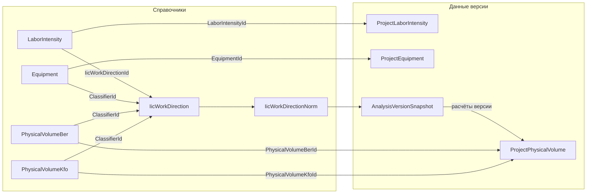

# Бизнес-логика Engineering Performance

**Дата ревизии:** 2026-08-23  
**Версия документа:** 1.2  
**Статус:** актуально **только для web-стека** (`backend/`, `client/`). WPF вне scope разработки.

**Политика:** см. [План развития: только Web](../plans/web-only-development-plan.md).

**Связанные документы:**
- [Единый SoT часов и Z](./hours-and-z-ssot.md)
- [Алгоритм прогнозирования](../features/forecast-algorithm.md)
- [Аналитика производительности](../features/performance-analytics.md)
- [Сравнение версий](../features/version-comparison.md)
- [Импорт данных](../features/data-import.md)
- [Отчёт ревизии web](../revision_report.md)
- [WPF — архив (не развиваем)](./wpf-reference-archive.md)

**Исходный код (единая точка математики):**
- `backend/EngineeringPerformance.Application/Services/PerformanceCalculationEngine.cs`
- `backend/EngineeringPerformance.Application/LaborIntensity/LaborIntensityCalculator.cs`
- `backend/EngineeringPerformance.Application/Analytics/ForecastCalculation.cs`

---

## 1. Назначение системы

Система **Engineering Performance** предназначена для инженерно-экономического анализа проектов проектирования:

1. **Планирование** — прогноз трудозатрат по физическим объёмам, нормам ИИС и сценариям Z.
2. **Оценка факта** — сравнение фактической производительности с нормативом (Z-score, интерпретация).
3. **Сравнение версий** — анализ изменений между итерациями проекта (план/факт).
4. **Тренды** — динамика показателей по версиям одного проекта.
5. **Справочники** — номенклатура, нормы, единицы измерения, характеристики.

Данные организованы вокруг **проекта** → **версии анализа** (`ProjectAnalysisVersion`) с направлением `Plan` (прогноз) или `Fact` (факт).

---

## 2. Глоссарий

| Термин | Описание |
|--------|----------|
| **ИИС / IIC** | Иерархия направлений работ (`IicWorkDirection`) — дисциплины проектирования |
| **КФО / БЭР** | Типы номенклатуры физических объёмов (`PhysicalVolumeType`); версия привязана к одному типу |
| **ФО / PPV** | Проектные физические объёмы (`ProjectPhysicalVolume`) |
| **LI / PLI** | Проектные трудозатраты (`ProjectLaborIntensity`) |
| **Норма** | `IicWorkDirectionNorm` — производительность N(V), отклонение σ, период действия |
| **Снимок норм** | `AnalysisVersionSnapshot` — заморозка норм на дату создания версии |
| **DocSet** | Комплект документации; связывает LI и PPV через `DocumentationCode` / `DocumentSet` |
| **Assessment** | Флаг `IsAssessment` — строка участвует в расчётах |
| **Z-score** | Стандартизированное отклонение фактической производительности от нормы |
| **PlanningScenario** | Алгоритм группировки при пересчёте LI на PPV |

---

## 3. Архитектура данных

### 3.1. Иерархия сущностей

```
Project
 └── ProjectAnalysisVersion (Direction: Plan | Fact)
      ├── PhysicalVolumeTypeId → КФО или БЭР
      ├── PlanningScenario (только Plan)
      ├── AnalysisVersionSnapshot[] → NormId по WorkDirectionId
      ├── ProjectVersionPlanningParameter[] → Z-параметры по IIC
      ├── ProjectPhysicalVolume[]
      ├── ProjectLaborIntensity[] (преимущественно Fact)
      ├── ProjectEquipment[]
      └── DataImportIteration[] (аудит импортов)
```

### 3.2. Принцип заморозки норм

Все расчёты версии (прогноз, факт, сравнение) используют **снимок норм** (`AnalysisVersionSnapshot`), созданный при создании или копировании версии по нормам, действовавшим на `CreatedAt`. Изменения в справочнике норм **не влияют** на уже созданные версии.

При копировании версии создаётся **новый** снимок по актуальным нормам на дату копии — историческая непрерывность норм не сохраняется.

### 3.3. Активный стек (web-only)

| Слой | Путь | Роль |
|------|------|------|
| **API** | `backend/EngineeringPerformance.Api/` | REST, auth, export |
| **Application** | `backend/EngineeringPerformance.Application/` | Расчёты, DTO, контракты |
| **Infrastructure** | `backend/EngineeringPerformance.Infrastructure/` | EF, импорт/экспорт (Export/), аналитика |
| **Frontend** | `client/src/` | React UI, AG Grid, отчёты |

Интеграция внешних модулей (Bearer JWT, JSON-ingest, OpenAPI): [_doc/api/README.md](../api/README.md).

Desktop (`EngineeringPerformance.App/`) **не рассматривается** при проектировании и приёмке. См. [wpf-reference-archive.md](./wpf-reference-archive.md).

**Внутренний техдолг web:** в `ProjectForecastService` остаётся scalar-ветка расчёта — см. раздел 5.9 (P-1).

---

## 4. Справочники и связи

### 4.1. Карта справочников

| Справочник | Сущность | Иерархия | Ключевые связи |
|------------|----------|----------|----------------|
| Группы ИИС | `IicWorkDirection` | Да | `UnitId` → ед. изм.; целевая привязка для ClassifierId |
| Нормы ИИС | `IicWorkDirectionNorm` | Регистр (периоды) | `WorkDirectionId` → IIC; формулы N(V), σ |
| Типы ФО | `PhysicalVolumeType` | Плоский | КФО / БЭР → выбор каталога версии |
| Номенклатура КФО | `PhysicalVolumeKfo` | Да | `ClassifierId`, `Coefficient`, `UnitId`, `IsAssessment`, `IicNormId`* |
| Номенклатура БЭР | `PhysicalVolumeBer` | Да | `ClassifierId`, `Coefficient`, `UnitId`, `IsAssessment` |
| Оборудование | `Equipment` | Да | `ClassifierId`, `Coefficient`, `UnitId`, `IsAssessment`, `CatalogKeyHash` |
| Трудоёмкость (каталог) | `LaborIntensity` | Да | `DocumentTypeName` (ключ импорта), `IicWorkDirectionId` |
| Единицы измерения | `UnitOfMeasurement` | Плоский | Используется во всех номенклатурах |
| Характеристики проекта | `ProjectCharacteristic` | Да + опции | Влияют на прогноз (характеристики версии) |

\* `IicNormId` на КФО **не используется** в расчётах — нормы берутся только через снимок по `ClassifierId` → `WorkDirectionId`.

### 4.2. Цепочка «справочник → проектные данные»



### 4.3. Правила привязки каталога к версии

Версия хранит `PhysicalVolumeTypeId`. Имя типа строго **«КФО»** или **«БЭР»** — определяет, какой каталог номенклатуры используется при импорте и отображении (`PhysicalVolumeCatalogBinding`).

`ProjectPhysicalVolume` содержит **взаимоисключающие** FK: `PhysicalVolumeKfoId` **или** `PhysicalVolumeBerId`.

Поля каталога для расчётов читаются через расширения:
- `GetClassifierId()` → направление ИИС
- `GetCoefficient()` → перевод в единицы группы ИИС
- `GetIsAssessment()` → участие в расчёте

### 4.4. Валидация справочников (текущее состояние)

| Операция | Поведение | Риск |
|----------|-----------|------|
| CRUD справочников | `Name` trim; для Equipment — пересчёт `CatalogKeyHash` | Нет проверки FK (`ClassifierId`, `UnitId`) |
| Удаление | Hard delete без проверки ссылок | FK-ошибки БД |
| Нормы ИИС | Запрет пересечения периодов; автозакрытие предыдущего периода | ✅ Строгая валидация |
| `GET /api/dictionaries/all` | Без ACL по отдельным справочникам | Утечка данных любому auth-пользователю |

### 4.5. API справочников

| Паттерн | Endpoint | Примеры |
|---------|----------|---------|
| Дерево-справочник | `GET/POST/PUT/DELETE /api/directories/{resource}` | `physical-volumes-kfo`, `equipment`, `labor-intensities`, `iic-work-directions`, `units-of-measurement` |
| Регистр норм | `GET/POST/PUT/DELETE /api/registers/iic-work-direction-norms` | Периоды действия, формулы |
| Bulk для UI | `GET /api/dictionaries/all` | Кэш Redis 30 мин |

---

## 4.6. DocSet-связка (LI ↔ PPV)

Связь трудоёмкости и физических объёмов через комплект документации:
- `ProjectLaborIntensity.DocumentationCode` — ключ документа (формат: `DocumentTypeName\|Brand`)
- `ProjectPhysicalVolume.DocumentSet` — комплект документации строки ФО
- Факт. часы строки: `setHours × (rowVol / setVol)`
- Оборудование: `CatalogKeyHash` (SHA-256 от Name + UnitId) — ключ автосоздания при импорте

## 5. Планирование трудозатрат (приоритетный модуль)

### 5.1. Входные данные

| Источник | Роль в планировании |
|----------|---------------------|
| `ProjectPhysicalVolume` (assessment) | Объём V_eff = Quantity × Coefficient |
| `ProjectEquipment` (assessment) | Дополнительный объём по ClassifierId |
| `AnalysisVersionSnapshot` | Нормы N(V), σ на дату версии |
| `ProjectVersionPlanningParameter` | Z pessimistic / base / optimistic по IIC |
| `PlanningScenario` | Алгоритм группировки при пересчёте LI |
| `ProjectLaborIntensity` | Вход **факта** (`PlannedHours`). Не fallback плана на web-пути при наличии снимка нормы |

**Важно:** Plan-версии по бизнес-правилу **не содержат** импортированных PLI (ISS-004). На web-пути при наличии формулы снимка `ComputeForecastHours(NormFormula)` **без** отката на `PlannedHours`. Scalar — только если формулы нет.

### 5.2. Формулы прогнозной трудоёмкости

Актуальная web-модель — только параметрическая (`LaborIntensityCalculator` + `ForecastHoursAggregator`). Сценарий версии задаёт, **откуда берётся N**, не какую из трёх колонок показать.

```
N(V) = NormCalculator(NormFormula, volume)     // 8 типов формул
σ    = DeviationCoefficientsJson                 // default: StdDev / Performance

LI(z) = N · (1 + σ × z) × V_eff
```

где `z ∈ {ZBase, ZOptimistic, ZPessimistic}`, `V_eff = Quantity × Coefficient`.  
Только строки PPV с оценкой «Да». Оборудование — per-item `N(V_eq)×z`, без сценария группировки.

Значения Z по умолчанию: pessimistic = 0.5, base = 0, optimistic = −0.5. Это **входы в часы**, не колонка Z-оценки.

Линейная запись `ФО × (Performance + Z × StdDev)` на web-пути **запрещена**.

### 5.3. Сценарии планирования (`PlanningScenario`)

| Сценарий | Алгоритм | Реализация |
|----------|----------|------------|
| `ByEachValue` | `N_i = N(V_i)` на каждой строке оценки | `LaborIntensityCalculator.RecalculateByEachValue` |
| `ByProjectIicGroup` | `V_g = ΣV_i` по группе IIC на проект → `N_g = N(V_g)` → доля `V_i/V_g` | `RecalculateByGroup(groupByFacility: false)` |
| `ByObjectIicGroup` | То же внутри объекта (`FacilityCode`) | `RecalculateByGroup(groupByFacility: true)` |

Строка с оценкой «Нет» не входит в `V_g`. Пересчёт в БД: `POST /api/projects/{id}/versions/{vid}/recalculate` пишет `LaborIntensity*` на ФО **и** оборудование и сбрасывает кэш проекта. Первый GET `page-data` заполняет Redis. Все неархивные версии: `scripts/recalculate-all-labor.sh`. Гриды, отчёт и сравнение **читают сохранённые колонки**; live `N(V)` на GET запрещён.

### 5.4. Поток расчёта прогноза (web)

```
1. Выбор версии Direction = Plan / Forecast
2. GET /api/projects/{id}/versions/{vid}/page-data
   └─ кэш page-data-encoded-v2 (поколение + TTL 12 ч), иначе один LoadAsync
      (пул EP-Analytics, singleflight summary+detail): PPV, PEQ (с LaborIntensity*), snapshots
3. ProjectsPageGridBuilder.BuildForecastGrids()
   ├─ StoredPlanHours (сумма колонок ФО + оборудование)
   └─ 3 грида: Summary, Facility, Detail
4. Z плана: BuildPlanPerformance → CalculatePerformance(stored hours)
5. UI: ForecastPanel / PlanningTab
```

Сессия (refresh, preferences) идёт в пул **EP-Interactive** и не ждёт Open() аналитики.

Persist (не GET): импорт/CRUD ФО и оборудования, смена сценария/Z, нормы ИИС, кнопка пересчёта → `RecalculateVersionAsync` → движок → БД → invalidate. Warm кэша на запросе persist **нет**.

### 5.5. Поток отчёта планирования

```
1. PerformanceReportService.BuildPlanBlock: BuildPlanPerformance (сохранённые часы, Base)
2. Часы KPI = Forecast GrandTotals.BaseHours (SUM колонок БД)
3. Z KPI = ComputeWeightedZFromPerformanceRows(planPerformance)
4. IProjectForecastService.GenerateForecastAsync: суммы stored часов по направлениям; без live N(V) на листьях
```

### 5.6. Редактирование плановых объёмов

`ForecastPlannedVolumePersistenceService` сохраняет пользовательские плановые объёмы по листьям дерева ИИС. При нескольких PPV с одним `ClassifierId` обнуляет все кроме первой — **упрощение**, теряющее детализацию по объектам.

### 5.7. UI планирования (web)

| Компонент | Функции |
|-----------|---------|
| `ForecastPanel` | 3 sub-tab (итого/объекты/детально), импорт ФО/оборудования, Z-параметры |
| `PlanningTab` | Дерево объёмов, preview/save planned volumes |
| `PlanningParametersDialog` | Z-сценарии, `PlanningScenario`, пересчёт LI |

### 5.8. API планирования

| Метод | Endpoint | Permission |
|-------|----------|------------|
| GET | `/api/projects/{id}/versions/{vid}/page-data` | Projects:Read |
| GET | `/api/projects/{id}/versions/{vid}/forecast` | Planning:Read |
| POST | `/api/projects/{id}/versions/{vid}/forecast/preview` | Planning:Read |
| POST | `/api/projects/{id}/versions/{vid}/forecast/calculate` | Planning:Read |
| PUT | `/api/projects/{id}/versions/{vid}/forecast/planned-volumes` | Planning:Edit |
| GET/PUT | `/api/projects/{id}/versions/{vid}/planning-parameters` | Planning |
| POST | `/api/projects/{id}/versions/{vid}/recalculate` | Planning:Edit |

### 5.9. Выявленные разрывы в планировании

| # | Проблема | Статус (2026-07-14) |
|---|----------|---------------------|
| P-1 | Два алгоритма: grid vs forecast report | **Закрыто (2026-08-24)** — persist + stored hours; см. hours-and-z-ssot.md |
| P-2 | Deep copy без PlanningScenario / LI-полей | **Закрыто** |
| P-3 | Scalar fallback / мёртвый additive API | **Закрыто** — `ComputeForecastScenarioHours` не найден в кодовой базе |
| P-4 | Plan без нормы/PLI → нулевые часы | **Частично** — UI warning (`normFallbackWarning`) |
| P-5 | `IicNormId` на КФО не используется | **Задокументировано** — не участвует в web-расчёте; схема без ADR не меняется |

---

## 6. Оценка факта (производительность, Z-score)

### 6.1. Входные данные

| Источник | Правило |
|----------|---------|
| PPV (assessment) | `factVolume = Σ(Quantity × Coefficient)` по ClassifierId |
| Equipment (assessment) | Добавляется к объёму по ClassifierId |
| PLI | `factHours = Σ(PlannedHours)` по WorkDirectionId — `ActualHours` существует в модели (`ProjectLaborIntensity.ActualHours`), но не участвует в агрегации |
| Снимок норм | `Estimate`, `StandardDeviation` или параметрические формулы |

### 6.2. Расчёт иерархии ИИС (вкладка «Итого»)

```
factProductivity = factHours / factVolume
factEstimate = ln(factProductivity)
zScore = (ln(hours / volume) − Estimate) / σ
```

Свёртка родителей и KPI — всегда `Σ(Z × hours) / Σ(hours)` (`ComputeWeightedZ`). Не среднее арифметическое, не штамп `ZBase`.

Для родительских узлов: взвешенное среднее по часам поддерева (тот же примитив движка).

План и факт используют **одну** формулу; различаются только источник часов (сохранённые `LaborIntensity*` vs `PlannedHours`). См. [hours-and-z-ssot.md](./hours-and-z-ssot.md).

### 6.3. Детальная оценка (DocSet-связка)

Связь LI ↔ PPV через комплект документации:

```
DocSet (LI) = часть DocumentationCode после "|"
DocumentSet (PPV) = комплект документации строки ФО

factHours (строка) = setHours × (rowVol / setVol)
zScore (строка) = (ln(factProductivity) - normEstimate) / normStdDev
```

Оборудование: строки остаются в гриде с объёмом; **факт. трудоёмкость не считается** из `vol × NormProductivity` (это формула прогноза). Без импорта LI колонка часов пустая — как на вкладке «Итого».

Непривязанные часы → строка **«(пусто)»**.

### 6.4. Интерпретация Z-score

| Z-score | Интерпретация |
|---------|---------------|
| < −1.0 | Отлично (Excellent) |
| −1.0 … −0.5 | Хорошо (Good) |
| −0.5 … 0.5 | Удовлетворительно (Satisfactory) |
| 0.5 … 1.0 | Требует внимания (NeedsAttention) |
| > 1.0 | Критично (Critical) |

Перцентиль: линейная шкала 10 корзин по Z ∈ [−1, 1].

### 6.5. API оценки факта

| Метод | Endpoint | Permission |
|-------|----------|------------|
| GET | `/api/projects/{id}/versions/{vid}/performance` | Assessment:Read |
| GET | `/api/projects/{id}/versions/{vid}/analysis` | Assessment:Read |
| GET | `/api/projects/{id}/versions/{vid}/page-data` | Projects:Read |

### 6.6. Разрывы в оценке факта

| # | Проблема |
|---|----------|
| F-1 | `ActualHours` импортируется, но не участвует в агрегации (осознанное правило ISS-006) |
| F-2 | LI без `WorkDirectionId` (несопоставленный каталог) → строка «(пусто)» |
| F-3 | Два способа взвешенного Z итога (pipeline vs totals calculator) — возможное расхождение |

---

## 7. Сравнение версий

### 7.1. Поток

```
versionA, versionB (один проект)
  → PerformanceService × 2 → Summary: ΔZ = Z_B − Z_A по WorkDirectionId
  → CalculateFactAssessment × 2 → merge Facility / Detail
  → CompareChart: top-N по |Δ|, метрики zScore / hours
```

Каждая версия использует **свой** снимок норм.

### 7.2. Уровни сравнения

| Уровень | Ключ merge | Метрики |
|---------|------------|---------|
| Summary (Итого) | WorkDirectionId | Z_A, Z_B, ΔZ, интерпретация B |
| Facility (По объектам) | FacilityCode | Часы A/B, Δ часы, Z |
| Detail (Детально) | (FacilityCode, DocumentSet, PvCode, WorkId) | Δ часы, наличие A+B |

Фильтр «только различия» — на клиенте: ΔZ ≠ 0 (4 знака) или разная интерпретация.

### 7.3. API

| Метод | Endpoint | Permission |
|-------|----------|------------|
| GET | `/api/projects/{id}/compare?versionA=&versionB=` | VersionComparison:Read |
| GET | `/api/projects/{id}/compare/chart` | VersionComparison:Read |
| GET | `/api/projects/{id}/compare/export.pdf` | VersionComparison:Read |

### 7.4. Ограничения

- Сравнение **только внутри одного проекта**
- Summary сравнивает Z из performance-дерева; facility/detail — из fact-assessment (разные уровни агрегации)

---

## 8. Трендовая аналитика

### 8.1. Поток (`TrendAnalyticsService`)

```
1. Версии проекта (не архивные), фильтр по CreatedAt
2. Разделение: Direction = Fact vs Plan/Forecast
3. FactAssessmentPipeline.EvaluateAsync per version → TotalFactLaborHours, weighted Z
4. Серии: factLaborHours, forecastLaborHours, hoursDelta, cumulativeFactHours
5. События: DataImportIterations + создание версий
6. Кэш Redis 10 мин
```

**Важно:** реализован **тренд одного проекта по версиям**, не группа проектов.

### 8.2. API

| Метод | Endpoint | Permission |
|-------|----------|------------|
| GET | `/api/analytics/trends` | GroupTrend:Read |
| GET | `/api/analytics/trends/detail` | GroupTrend:Read |
| GET | `/api/analytics/trends/export.pdf` | GroupTrend:Read |
| GET | `/api/projects/{id}/group-trend` | **Заглушка** |

### 8.3. Ограничения

- `GroupAnalyticsService` — **реализован**: агрегация по Program/Customer через `FactAssessmentPipeline`
- `GET .../group-trend` — thin DTO со ссылкой на `/analytics/trends` (проектный тренд)
- Permission `GroupTrend` исторически назван «группа», фактически используется и для project trends
- `granularity` в API принимается, ось фактически — версии/даты

---

## 9. Импорт данных

### 9.1. Общий поток

```
Excel (.xlsx, ≤50 MB) → ExcelUploadValidator
  → ImportController [ProjectDataUpload:Edit + проект:Edit]
  → ProjectExcelDataImportService
  → транзакция + DataImportIteration
```

Стратегия **Replace** в рамках версии.

### 9.2. Импорт физических объёмов

| Шаг | Правило |
|-----|---------|
| Сопоставление | По `Code` каталога; нормализация EP-кодов (тире, zero-padding, regex БЭР/КФО) |
| Дубли кода | Эвристика: с ClassifierId → длиннейший Code → меньший Id |
| Пропуск | Строки без EP-кода или без совпадения в каталоге |
| Backfill | ClassifierId из цепочки предков, если у листа NULL |

### 9.3. Импорт трудозатрат

| Шаг | Правило |
|-----|---------|
| Сопоставление | `DocumentTypeName` → `LaborIntensity` (case-insensitive, trim) |
| WorkDirectionId | Из `LaborIntensity.IicWorkDirectionId` (может остаться NULL) |
| DocumentationCode | `DocumentTypeName` или `DocumentTypeName\|Brand` |
| Merge | По (DocumentationCode, WorkDirectionId) с **суммированием** часов (ISS-006) |
| Опция | `addMissingToCatalog` — создаёт корневые LI **без** IIC-направления |

**Примечание:** поле `Techas` в каталоге `LaborIntensity` — legacy; web-импорт использует только `DocumentTypeName`.

### 9.4. Импорт оборудования

| Шаг | Правило |
|-----|---------|
| Сопоставление | `Name` + `UnitId` → `CatalogKeyHash` (SHA-256) |
| Автосоздание | Позиции каталога при отсутствии |
| Валидация | `EquipmentImportDictionaryValidator` (UnitId, DirectionId, NormType) |

### 9.5. Откат импорта

`DELETE .../import/{dataType}/iterations?importedAt=` — удаляет записи с данным `importedAt`, не полный snapshot «до импорта».

### 9.6. Разрывы импорта

| # | Проблема |
|---|----------|
| I-1 | Монолит ~2400+ строк, мало API integration-тестов |
| I-2 | Импорт списка проектов (`ProjectsController.ImportExcel`) — stub |
| I-3 | Дубли кодов в каталоге ФО допустимы — риск неверной привязки |
| I-4 | Автосоздание LI без IIC требует ручной доработки справочника |

---

## 10. Отчёты и экспорт

### 10.1. Слои экспорта

| Сервис | Расположение | Форматы | Данные |
|--------|-------------|---------|--------|
| `AnalyticsExportService` | `Export/` | xlsx, pdf | Анализ версии, прогноз |
| `ProjectExportService` | `Export/` | xlsx, pdf | 9 гридов, сводные таблицы |
| `VisualReportService` | `Export/` | pdf + графики | ScottPlot → PNG → QuestPDF |

Экспорт **паритетен UI**: данные через `IProjectsPageDataFetcher` и сервисы аналитики.

### 10.2. Ключевые endpoints

| Область | Примеры |
|---------|---------|
| Прогноз | `.../export/forecast-summary.pdf`, `forecast-facility/excel`, `forecast-detail/excel` |
| Факт | `.../export/fact-summary.pdf`, `analysis.pdf`, `fact-detail/pdf` |
| Сравнение | `.../compare/export.pdf?section=summary\|facility\|detail\|full` |
| Тренды | `/api/analytics/trends/export.pdf` |
| Сводный | `.../export/combined.pdf` |

---

## 11. Права доступа

### 11.1. Двухуровневая модель

| Уровень | Проверка |
|---------|----------|
| Глобальная матрица | `AccessRights` (роль × ObjectName × Read/Edit) → `[HasPermission]` |
| Доступ к проекту | `ProjectPermissions` (user × project × level) → `[RequireProjectAccess]` |
| Администратор | Обходит обе проверки |

### 11.2. Маппинг модулей

| Модуль | PermissionType |
|--------|----------------|
| Планирование / прогноз | `Planning` |
| Оценка факта | `Assessment` |
| 9 гридов, page-data | `Projects` |
| Сравнение версий | `VersionComparison` |
| Тренды | `GroupTrend` |
| Импорт Excel | `ProjectDataUpload` (Edit) |
| Справочники (UI) | `References` + объектные права |
| Матрица прав | Administrator only |

### 11.3. Известные пробелы ACL

- `GET /api/dictionaries/all` без ролевой фильтрации по справочникам
- Вкладки проекта в UI видны без проверки permission
- `DirectoriesController` использует `EnsureAccessAsync`, не `[HasPermission]` — два паттерна

---

## 12. Сводная матрица: справочник → расчёт

| Выход расчёта | Справочники / данные | Формула / правило |
|---------------|----------------------|-------------------|
| Прогноз LI (гриды, ForecastPanel) | PPV/оборудование assessment, колонки `LaborIntensity*` | SUM сохранённых `N(V)·(1+σz)·V_eff` |
| Прогноз LI (отчёт планирования) | те же колонки `LaborIntensity*` | SUM по направлениям, без live N(V) |
| Fact Z-score (итого) | PPV + PLI PlannedHours + norm snapshot | log(productivity), взвешенная агрегация |
| Fact hours (детально) | PLI по DocSet + PPV DocumentSet | `setHours × (vol/setVol)` |
| Fallback часов | Нет нормы | `Σ PlannedHours` по WorkDirectionId |
| Объём по ИИС | PPV + Equipment assessment | `Σ Quantity × Coefficient` |
| Сравнение ΔZ | 2 версии × 2 snapshot | `Z_B − Z_A` |
| Тренд hoursDelta | Fact + Plan версии | `factHours − nearestForecastHours` |

---

## 13. Девять гридов ProjectsPage — формирование

| # | Грид | Направление | Источник |
|---|------|-------------|----------|
| 1 | Прогноз — Итого | Plan | `ProjectsPageGridBuilder` + `LaborIntensityCalculator` |
| 2 | Прогноз — По объектам | Plan | Группировка PPV + equipment по Facility |
| 3 | Прогноз — Детально | Plan | 1 PPV → 1 строка |
| 4 | Факт — Итого | Fact | `PerformanceCalculationEngine.CalculatePerformance` |
| 5 | Факт — По объектам | Fact | `CalculateFactAssessment` → агрегация по Facility |
| 6 | Факт — Детально | Fact | DocSet-пропорция LI |
| 7 | Сравнение — Итого | A vs B | 2× performance → merge |
| 8 | Сравнение — По объектам | A vs B | 2× fact facility → merge |
| 9 | Сравнение — Детально | A vs B | 2× fact detail → merge |

Единая точка загрузки: `GET /api/projects/{id}/versions/{vid}/page-data`.

---

## 14. Рекомендации по устранению разрывов

### Закрыто (аудит 2026-07-14)

1. Унификация прогноза + FIX-01 parent scenario path (P-1/P-3).
2. Deep copy PlanningScenario / LI-поля (P-2).
3. UI warning fallback (P-4 частично).
4. FK справочников + soft-check delete.
5. ACL dictionaries + gate вкладок.
6. Единый weighted Z + единая база часов факта (`FactLaborHoursTotals`).
7. Групповой анализ Program/Customer; group-trend → trends page.
8. BER `physicalVolumeKfoId` убран из UI.
9. PDF: DejaVu, портал-тема, иерархия, шкала Z, KPI оценки.

### Остаётся

10. Fixture happy-path импорта (S1-05); импорт списка проектов (501).
11. CRUD `PhysicalVolumeType` в web UI.
12. SPNEGO prod / разбиение монолита импорта.
13. E2E/UAT расширение.

---

## 15. Ключевые файлы по областям

### Планирование
- `backend/EngineeringPerformance.Application/LaborIntensity/LaborIntensityCalculator.cs`
- `backend/EngineeringPerformance.Application/Analytics/ForecastCalculation.cs`
- `backend/EngineeringPerformance.Infrastructure/Analytics/ProjectsPageGridBuilder.cs`
- `backend/EngineeringPerformance.Infrastructure/Analytics/ProjectForecastService.cs`
- `backend/EngineeringPerformance.Infrastructure/LaborIntensityServices/LaborIntensityRecalculationService.cs`
- `client/src/features/projects/forecast/ForecastPanel.tsx`

### Справочники
- `backend/EngineeringPerformance.Infrastructure/Directories/DirectoryFacade.cs`
- `backend/EngineeringPerformance.Infrastructure/Registers/IicWorkDirectionNormService.cs`
- `backend/EngineeringPerformance.Infrastructure/Dictionaries/CachedDictionaryService.cs`
- `backend/EngineeringPerformance.Infrastructure/Projects/PhysicalVolumeCatalogBinding.cs`
- `client/src/pages/references/directoryFieldConfig.ts`

### Оценка факта
- `backend/EngineeringPerformance.Application/Services/PerformanceCalculationEngine.cs`
- `backend/EngineeringPerformance.Infrastructure/Analytics/PerformanceService.cs`
- `backend/EngineeringPerformance.Infrastructure/Analytics/FactAssessmentPipeline.cs`
- `backend/EngineeringPerformance.Infrastructure/Analytics/FactAssessmentEngineMapper.cs`

### Импорт
- `backend/EngineeringPerformance.Infrastructure/Import/ProjectExcelDataImportService.cs`

### Сравнение и тренды
- `backend/EngineeringPerformance.Infrastructure/Analytics/ProjectCompareService.cs`
- `backend/EngineeringPerformance.Infrastructure/Analytics/TrendAnalyticsService.cs`

---

## 16. История изменений документа

| Дата | Версия | Изменение |
|------|--------|-----------|
| 2026-07-26 | 1.2 | Обновлены пути экспорт-сервисов на `Export/`; заменён `FactAssessmentRowsCalculator` на `FactAssessmentPipeline` + `FactAssessmentEngineMapper`; добавлена секция 4.6 (DocSet-связка); уточнены статусы P-1 и P-3 |
| 2026-07-14 | 1.1 | Web-only: WPF вне scope; разрывы пересмотрены как внутренний техдолг web; ссылка на план развития |
| 2026-07-14 | 1.0 | Первичная полная ревизия бизнес-логики |
