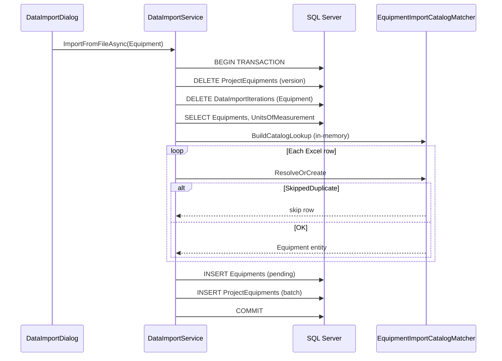

# Data Access Inventory — Engineering Performance (WPF / EF Core)

**Дата:** 2026-06-08  
**Версия:** 1.0  
**Связанные документы:** [business_logic_inventory.md](./business_logic_inventory.md), [equipment-module.md](../plans/equipment-module.md)  
**Источник граничных условий:** `EngineeringPerformance.Tests/` (23 файла), не `.src`

---

## Обзор доступа к данным

| Аспект | Реализация |
|--------|------------|
| ORM | EF Core 8, `AppDbContext` (`EngineeringPerformance.Infrastructure/Data/`) |
| Паттерн | Сервисы напрямую через `IDbContextFactory<AppDbContext>`; отдельного слоя Repository нет |
| Хранимые процедуры | **Не используются** (`FromSql` / `ExecuteSql` в коде не найдены) |
| Миграции | `EngineeringPerformance.Infrastructure/Migrations/` |
| Web-дубликат | `backend/EngineeringPerformance.Infrastructure/Persistence/` — отдельный `AppDbContext`, та же схема |

**Сущности в `AppDbContext` (22 DbSet):** Users, Roles, Projects, ProjectAnalysisVersions, PhysicalVolumeTypes, PhysicalVolumes, Equipments, IicWorkDirections, IicWorkDirectionNorms, UnitsOfMeasurement, ProjectPhysicalVolumes, ProjectEquipments, ProjectLaborIntensities, ProjectPermissions, AccessRights, DataImportIterations, LaborIntensities, ProjectCharacteristics (+ Options, Selections), AnalysisVersionSnapshots, UserSettings, UserActionLogs.

---

## Производительность: 9 гридов `ProjectsPageView`

### Схема загрузки

```
LoadForecastDataAsync (гриды 1–3)
  ├─ Task.WhenAll(
  │     PerformanceService.GetPerformanceDataAsync,    // 5–6 SQL round-trips
  │     ProjectVersionGridDataService.LoadAsync)       // 5 SQL round-trips (1 контекст)
  └─ CPU: ProjectsPageViewModel (без БД)

LoadFactDataAsync (гриды 4–6)
  ├─ Task.WhenAll(PerformanceService, GridDataService + IncludeLaborIntensities)
  └─ CPU: ComputeFactRows

LoadCompareDataAsync (гриды 7–9)
  ├─ GetPerformanceDataAsync × 2 (последовательно внутри метода)
  ├─ LoadFactDataForCompareAsync × 2 (последовательно — «правило из памяти»)
  └─ CPU: BuildCompare* + FilterCompare*
```

### `PerformanceService.GetPerformanceDataAsync`

| Практика | Статус |
|----------|--------|
| `.AsNoTracking()` | ✅ На всех запросах |
| `.Include()` | `PhysicalVolume`, `Equipment`, `Norm` (snapshots) |
| `.AsSplitQuery()` | ✅ Только на `ProjectPhysicalVolumes` + Include |
| N+1 | ❌ Нет — пакетная загрузка, агрегация в памяти |
| Параллелизм | ✅ **5 отдельных `DbContext`** + кэш IIC (`_workDirectionsCache`) |
| Риск | ⚠️ **5+ подключений к БД на один вызов**; при Compare ×2 = 10+ conn |

### `ProjectVersionGridDataService.LoadAsync`

| Запрос | Include | Фильтр | Риск |
|--------|---------|--------|------|
| `IicWorkDirections` → Dictionary | `Unit` (опционально) | все | Один SELECT на всё дерево IIC |
| `ProjectPhysicalVolumes` (assessment) | `PhysicalVolume.Unit` | `IsAssessment && ClassifierId != null` | Дублирует часть запроса PerformanceService |
| `ProjectPhysicalVolumes` (all) | `PhysicalVolume.Unit` | по project+version | **Дублирование** с assessment-запросом |
| `ProjectEquipments` | `Equipment` | по project+version | OK |
| `AnalysisVersionSnapshots` | — | ToDictionary | OK |
| `ProjectLaborIntensities` | — | `Select` проекция | ✅ Без лишних Include |

| Практика | Статус |
|----------|--------|
| `.AsNoTracking()` | ✅ |
| N+1 | ❌ Нет |
| Риск | ⚠️ **Два полных SELECT PPV** (assessment + all); при Forecast/Fact вызывается вместе с PerformanceService → **перекрывающиеся данные** |

### Итог по 9 гридам

| Грид | DB-вызовы при открытии вкладки | Главный риск миграции |
|------|-------------------------------|------------------------|
| ForecastGrid, FacilityForecastGrid, DetailForecastGrid | ~11 round-trips | Дубли PPV между Performance + GridData |
| FactPerformanceGrid, FactFacilityGrid, FactDetailGrid | ~11 + LI | То же + LI без merge в runtime |
| CompareGrid, CompareFacilityGrid, CompareDetailGrid | ~22+ (2 версии) | Последовательные LoadFact; нет единого API batch |

**Рекомендация для web:** один endpoint `GET /projects/{id}/versions/{vid}/dashboard` с объединённым DTO вместо 2 сервисов × N контекстов.

---

## Таблица: ProjectPhysicalVolumes

### Структура (EF: `ProjectPhysicalVolumeConfiguration`)

| Колонка | Тип | Nullable | Default | Примечание / Связи |
|---------|-----|----------|---------|-------------------|
| Id | INT | NO | IDENTITY | PK |
| ProjectAnalysisVersionId | INT | NO | — | FK → ProjectAnalysisVersions **Cascade Delete** |
| ProjectId | INT | NO | — | FK → Projects **Restrict** |
| PhysicalVolumeId | INT | NO | — | FK → PhysicalVolumes **Restrict** |
| Quantity | DECIMAL(18,4) | NO | — | |
| FacilityCode | NVARCHAR(100) | YES | — | Индекс на CatalogId |
| FacilityName | NVARCHAR(500) | YES | — | |
| DocumentSet | NVARCHAR(100) | YES | — | Ключ связи с LI (хвост после `\|`) |
| WorkId | NVARCHAR(200) | YES | — | Ключ сравнения версий |
| Status | NVARCHAR(50) | YES | — | UI-поле; конвертер не привязан |
| CreatedAt | DATETIME2 | NO | UtcNow | Маркер итерации импорта (удаление по `CreatedAt == importedAt`) |
| ModifiedAt | DATETIME2 | YES | — | |

**Индекс:** `(ProjectAnalysisVersionId, ProjectId, PhysicalVolumeId)` — не уникальный (много строк на одну номенклатуру).

### Запросы из кода

| Метод / Сервис | Операция | LINQ (упрощённо) | Оптимизация / РИСКИ | Используется в |
|----------------|----------|------------------|---------------------|----------------|
| `GetPerformanceDataAsync` | SELECT | `PPV.Where(project, version).Include(PhysicalVolume)` + `AsSplitQuery` | ✅ NoTracking; загружает **все** PPV версии | Grids 1–6, 7 (через perf) |
| `ProjectVersionGridDataService.LoadAsync` | SELECT ×2 | assessment filter + all PPV | ⚠️ Дубль запросов | Grids 1–6 |
| `ImportPhysicalVolumesAsync` | DELETE+INSERT | `ClearPhysicalVolumeDataForVersionAsync` → `RemoveRange` + `AddRange` | Транзакция; replace-стратегия | DataImportDialog |
| `BackfillPhysicalVolumeClassifiersFromAncestorsAsync` | UPDATE | `foreach pvId: PhysicalVolumes.FirstOrDefaultAsync` | ⚠️ **N+1** при большом каталоге | Импорт ФО |
| `ProjectAnalysisVersionCopyService` | INSERT | `AsNoTracking` source → `Add` копии | Транзакция | WPF copy (полный) |
| `ProjectVersionService.CopyAsync` (web) | INSERT | Только `ProjectAnalysisVersions` + snapshot | ⚠️ **GAP: без PPV** | Web API |

---

## Таблица: ProjectEquipments

### Структура (EF: `ProjectEquipmentConfiguration`)

| Колонка | Тип | Nullable | Примечание |
|---------|-----|----------|------------|
| Id | INT | NO | PK |
| ProjectAnalysisVersionId | INT | NO | FK **Cascade Delete** |
| ProjectId | INT | NO | FK Restrict |
| EquipmentId | INT | NO | FK → Equipments Restrict |
| Quantity | DECIMAL(18,4) | NO | |
| QuantityInWork | DECIMAL(18,4) | YES | Из Excel |
| CatalogName | NVARCHAR(MAX) | YES | До ~2300 симв. (образец) |
| FacilityCode | NVARCHAR(100) | YES | Индекс |
| … | | | PositionNumber, DocumentSet, Tag, … |

### Запросы

| Метод | Операция | Риски | Гриды |
|-------|----------|-------|-------|
| `GetPerformanceDataAsync` | SELECT + Include(Equipment) | OK | 1–6 |
| `GridDataService.LoadAsync` | SELECT + Include(Equipment) | Дубль с Performance | 1–6 |
| `ImportEquipmentAsync` | DELETE+INSERT в транзакции | См. раздел «Транзакционность» | Import |
| `ProjectAnalysisVersionCopyService` | — | ⚠️ **Equipment не копируется** | Copy WPF |

---

## Таблица: ProjectLaborIntensities

### Структура (EF: `ProjectLaborIntensityConfiguration`)

| Колонка | Тип | Nullable | Примечание |
|---------|-----|----------|------------|
| Id | INT | NO | PK |
| ProjectAnalysisVersionId | INT | NO | FK **Cascade Delete** |
| DocumentationCode | NVARCHAR(450) | NO | Ключ merge: `(DocumentationCode, WorkDirectionId)` |
| WorkDirectionId | INT | YES | FK Restrict; NULL при несовпадении каталога |
| LaborIntensityId | INT | YES | FK SetNull |
| PhysicalVolumeId | INT | YES | FK **SetNull** on delete PV |
| PlannedHours | DECIMAL(18,4) | NO | **Единственный источник часов для PerformanceService** |
| ActualHours | DECIMAL(18,4) | NO | Импортируется, но не в агрегации perf |

**Индексы:** `(ProjectAnalysisVersionId, ProjectId)`, Brand, LaborIntensityId, PhysicalVolumeId.

### Запросы и merge

| Метод | Операция | Примечание |
|-------|----------|------------|
| `ImportLaborIntensitiesAsync` | DELETE all LI версии + `AddRange` построчно | **MergeLaborRowsByNaturalKey не вызывается** в runtime WPF |
| `MergeLaborRowsByNaturalKey` | In-memory only | Public static; тестируется; дублирован в `backend/.../ProjectExcelDataImportService` |
| `GridDataService` | SELECT проекция | Fact grids 4–6 |

---

## Таблица: ProjectAnalysisVersions

### Структура

| Колонка | Тип | Nullable | Примечание |
|---------|-----|----------|------------|
| Id | INT | NO | PK |
| ProjectId | INT | NO | FK |
| VersionName | NVARCHAR(200) | NO | |
| Direction | INT (enum) | NO | Plan / Fact → `AnalysisDirectionToStringConverter` |
| PhysicalVolumeTypeId | INT | YES | FK SetNull |
| IsArchived | BIT | NO | Фильтр списков |
| CreatedAt | DATETIME2 | NO | База для snapshot норм |

**Каскады на дочерние:** PPV, PLI — Cascade (в конфигурации версии); ProjectEquipment — Cascade (отдельная конфигурация).

---

## Таблица: AnalysisVersionSnapshots

| Колонка | Тип | Примечание |
|---------|-----|------------|
| ProjectAnalysisVersionId | INT | FK Cascade |
| WorkDirectionId | INT | FK Restrict |
| NormId | INT | FK Restrict |
| **UX** | | `(ProjectAnalysisVersionId, WorkDirectionId)` UNIQUE |

Заполняется при создании/копии версии (`PopulateSnapshotAsync` / `ProjectAnalysisVersionCopyService`).

---

## Таблица: Equipments (справочник)

| Колонка | Тип | Примечание |
|---------|-----|------------|
| Name | NVARCHAR(MAX) | Required; сопоставление импорта **Ordinal** |
| CatalogKeyHash | CHAR(64) | UNIQUE; SHA-256(Name+UnitId) |
| UnitId | INT | FK SetNull |
| ClassifierId | INT | FK SetNull |
| IsAssessment | BIT | NULL=tri-state в UI |
| Coefficient | DECIMAL(18,4) | Default 1 |

Импорт: один `SELECT * FROM Equipments` + in-memory `EquipmentImportCatalogMatcher` — **без N+1 на строки Excel**.

---

## Таблица: PhysicalVolumes (справочник)

| Колонка | Тип | Примечание |
|---------|-----|------------|
| Code | NVARCHAR(50) | Импорт: `OrdinalIgnoreCase` lookup |
| ClassifierId | INT | Backfill от предков при импорте |
| Coefficient | DECIMAL(18,4) | Default 1 |
| IsAssessment | BIT | Фильтр расчёта |

---

## Импорт: взаимодействие с БД

### Общая модель

| Тип импорта | Транзакция | Стратегия данных | Массовые операции |
|-------------|------------|------------------|-------------------|
| PhysicalVolume | `BeginTransactionAsync` | **Replace** (clear + insert) | `AddRange`, `RemoveRange` |
| Equipment | `BeginTransactionAsync` | **Replace** | `Equipments.AddRange` (autocreate) + `ProjectEquipments.AddRange` |
| LaborIntensity | `BeginTransactionAsync` | **Replace** | `AddRange` (без merge в WPF) |

### `EquipmentImportCatalogMatcher` и БД

| Этап | Обращение к БД |
|------|----------------|
| Начало импорта | `Equipments.AsNoTracking().ToListAsync()` — **1 запрос** |
| | `UnitsOfMeasurement.AsNoTracking().ToListAsync()` — **1 запрос** |
| Цикл Excel (N строк) | **0 запросов** — lookup в `Dictionary<EquipmentCatalogKey, Equipment>` |
| Autocreate | `pendingCatalogCreates` → `AddRange` + один `SaveChangesAsync` |
| Пропуск дубликата каталога | Только `continue` + log; **не откат транзакции** |

**Вывод:** N+1 на строки Excel **отсутствует**. Matcher — чистая in-memory логика после prefetch.

### `MergeLaborRowsByNaturalKey` и БД

| Аспект | Факт |
|--------|------|
| Вызывается при импорте WPF? | **Нет** (импорт LI построчный с ISS-006 truncate 450) |
| Назначение | Контракт для тестов и потенциальный backend-merge |
| БД | Только если вызывающий код применит результат к `Add`/`Update` |

### Транзакционность: сценарий «1000 строк, ошибка в середине»

#### Equipment: «ошибка» = ambiguous duplicate (SkippedDuplicate)

```csharp
// ImportEquipmentAsync — псевдокод
BeginTransaction();
ClearEquipmentDataForVersionAsync();  // SaveChanges внутри транзакции
// ... цикл: skipped duplicate → continue (не exception)
if (newEntities.Count == 0) { Commit; return 0 rows; }
AddRange(pendingCatalogCreates + newEntities);
SaveChanges(); Commit();
```

| Исход | Поведение |
|-------|-----------|
| 500 skipped + 500 OK | **Commit**: в БД 500 строк; старые данные **удалены** (replace) |
| Exception на `SaveChanges` | `await using transaction` → **Rollback**; данные версии **восстанавливаются** |
| Exception при парсинге Excel | `ImportFromFileAsync` catch → `Success=false`; транзакция **не закоммичена** → rollback |

⚠️ **Важно:** skipped duplicate — **не ошибка**, а штатное поведение. Пользователь получает частичный импорт + сводку в `SuccessDetails`.

#### Labor: ошибка layout

```csharp
if (!TryResolveLaborIntensityImportLayout) {
    await transaction.RollbackAsync();
    return Success=false;
}
```

Явный rollback при неверной структуре файла **до** записи LI.

#### PhysicalVolume: пустой каталог / все строки skip

`Success=true`, `RecordsImported=0`, детали в `SuccessDetails`; транзакция commit (версия остаётся **без PPV** после clear).

### Тесты целостности (3–5 ключевых из `EngineeringPerformance.Tests`)

| Тест | Что фиксирует для БД |
|------|---------------------|
| `MergeLaborRowsByNaturalKey_DuplicateKey_SumsPlannedAndActualHours` | Контракт слияния LI по `(DocumentationCode, WorkDirectionId)` — сумма 24.75/5.0 |
| `MergeLaborRowsByNaturalKey_DistinctKeys_KeepsRowsSeparate` | `WorkDirectionId=null` → unmatched, не в merge |
| `DataImportServiceTests.DeleteIteration_*` | `DeleteIterationAsync` требует реальную БД с транзакциями (InMemory падает) |
| `DataImportServiceTests.ImportFromFile_FileNotFound_*` | Нет side-effects в БД при отсутствии файла |
| `PerformanceServiceTests.GetPerformanceData_EmptyDatabase_ReturnsPlaceholderOnly` | Контракт UI: не пустой список на пустой БД |
| `EquipmentImportCatalogMatcherTests.ResolveOrCreate_AmbiguousCatalogKey_SkipsDuplicate` | In-memory: дубликат каталога → skip без insert |
| `ProjectVisibilityServiceTests.NonAdmin_CannotAccess_ProjectWithoutPermission` | ACL: нет `ProjectPermission` → нет доступа |

---

## Хранимые процедуры и сложные операции

| Имя / Метод | Назначение | Особенности БД |
|-------------|------------|----------------|
| `EquipmentImportCatalogMatcher` | Поиск эталона оборудования | **In-memory** после 2 prefetch SELECT; N+1 **нет** |
| `MergeLaborRowsByNaturalKey` | Слияние LI | **In-memory**; в WPF-импорте **не вызывается** |
| `ProjectAnalysisVersionCopyService.CopyVersionAsync` | Полное копирование версии (WPF) | Транзакция: PPV + PLI (Fact) + Iterations + **новый** Snapshot; **без Equipment** |
| `ProjectVersionService.CopyAsync` (web) | Копия версии API | Только шапка + `PopulateSnapshotAsync`; **без PPV/PLI/Equipment** — осознанный GAP |
| `DeleteIterationAsync` | Откат итерации импорта | Транзакция: delete by `CreatedAt == importedAt` |
| `BackfillPhysicalVolumeClassifiersFromAncestorsAsync` | UPDATE каталога PV | ⚠️ N× `FirstOrDefaultAsync` |

### GAP: CopyProjectVersion — почему нет дочерних данных (web)

| Причина | Деталь |
|---------|--------|
| Не каскад EF | Каскад удаления настроен; **копирование** — явный код, не триггер БД |
| Web `CopyAsync` | Копирует только `ProjectAnalysisVersion` + snapshot норм; **нет цикла по PPV/PLI/Equipment** |
| WPF `ProjectAnalysisVersionCopyService` | Копирует PPV, PLI (если Fact), Iterations, генерирует snapshot; **Equipment всё равно не копируется** |
| Исправление | Добавить блоки copy для `ProjectEquipments` + унифицировать web/WPF |

---

## РАЗВИЛКИ в доступе к данным (ACL)

### Глобальные права (`AccessControlService`)

```csharp
if (user.Role == Administrator) return true;
return GetEffectiveAccessLevel(user, objectName) >= requiredLevel;
// Кэш прав по RoleId; объекты: "Users", "Projects", "Assessment", …
```

| Операция | Развилка |
|----------|----------|
| `CanEdit(user, "Projects")` | Administrator **или** `AccessRights` с `AccessLevel >= Edit` |
| `GetAccessibleObjects` | Фильтр по уровню из `AccessRights` |

**Тест:** `AccessControlServiceTests` — Admin full; Manager Edit; Observer Read only.

### Доступ к проектам (`ProjectVisibilityService`)

```csharp
// GetAccessibleProjectsAsync
if (!isAdmin)
    query = query.Where(p => ProjectPermissions.Any(pp => pp.ProjectId == p.Id && pp.UserId == user.Id));
// НЕ фильтр по CreatedById — модель ProjectPermission
```

| Операция | Развилка |
|----------|----------|
| `CanUserAccessProjectAsync` | Admin → true; иначе `ProjectPermissions` + проект не archived |
| `GetAccessibleProjectsAsync` | Subquery `ProjectPermissions`; ⚠️ `AnalysisVersions.Count` в проекции — correlated count |

### Импорт / удаление данных версии

| Операция | Проверка в коде |
|----------|-----------------|
| `DataImportDialog` | Права на уровне UI (`ProjectsPageViewModel` + `AccessControlService`); сервис импорта **не проверяет ACL** |
| `DeleteIterationAsync` | Только по `(projectId, versionId, dataType, importedAt)` — **нет проверки «закрытая версия»** |
| `Clear*ForVersionAsync` | Полная замена при импорте — версия должна быть выбрана в UI |

### Справочники (`DirectoryServiceBase`)

```csharp
GetAllAsync → AsNoTracking, filter !IsArchived, OrderBy SortOrder, Name
// Serilog [PERF] логирование времени запроса
```

---

## 12 конвертеров ↔ поля БД / DTO

| Конвертер | Поле / источник данных | Таблица / вычисление |
|-----------|------------------------|----------------------|
| `AnalysisDirectionToStringConverter` | `ProjectAnalysisVersion.Direction` | `ProjectAnalysisVersions.Direction` (enum int) |
| `InterpretationToBrushConverter` | `PerformanceItem.Interpretation` (string) | Вычисляется из `PerformanceInterpretation` → `ToRussian()`; не колонка БД |
| `BoolToTotalBackgroundConverter` | `ForecastPerformanceItem.IsTotal` | **VM only** (не в БД) |
| `BoolToFontStyleConverter` | `ForecastPerformanceItem.IsTotal` | VM only |
| `BoolToFontWeightConverter` | Права UI (bool flags) | `AccessRights` editing state |
| `IndentToMarginConverter` | `PerformanceRowDto.Level` / tree level | Из иерархии `IicWorkDirections.ParentId` |
| `NullToCollapsedConverter` | Nullable FK/display (напр. выбранная версия) | Various nullable UI bindings |
| `NullToBoolConverter` | Nullable selection | — |
| `BoolToVisibilityConverter` | Feature flags, `IsLoading` | — |
| `InverseBooleanToVisibilityConverter` | Инверсия видимости панелей | — |

**`EnumToDescriptionConverter` в проекте не найден** — вместо него `AnalysisDirectionToStringConverter` и `PerformanceInterpretation.ToRussian()` в VM.

**`ProjectPhysicalVolume.Status` (NVARCHAR):** в БД есть, отдельного конвертера нет — отображается как string.

---

## Диаграмма: импорт Equipment (транзакция)



---

## GAP и риски для миграции (data layer)

1. **Дублирующие SELECT** PPV/Equipment между `PerformanceService` и `GridDataService`.
2. **N+1** в `BackfillPhysicalVolumeClassifiersFromAncestorsAsync`.
3. **Web CopyAsync** без дочерних таблиц; WPF copy без Equipment.
4. **MergeLaborRowsByNaturalKey** протестирован, но не в runtime WPF-import — риск расхождения с backend.
5. **Импорт replace**: успешный commit с 0 строк после clear → потеря данных версии (by design).
6. **Нет ACL в `DataImportService`** — только UI gate.
7. **Два AppDbContext** (legacy + backend) — parity миграций обязательна.

---

*Документ сформирован по `EngineeringPerformance.Infrastructure/Data`, сервисам доступа и тестам `EngineeringPerformance.Tests/`.*
