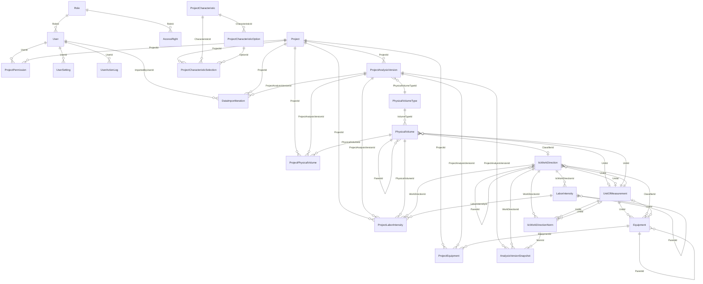

# Карта миграции WPF → Web

**Дата:** 2026-06-08  
**Источник:** инвентаризация `EngineeringPerformance.App` (WPF), `EngineeringPerformance.Infrastructure` (EF Core), `EngineeringPerformance.Core` (контракты сервисов)  
**Статус:** черновик для планирования веб-версии  
**Язык:** русский (документация)

---

## 1. Цели миграции

### 1.1. Бизнес-цели

- Перенести десктопное WPF-приложение в браузерный доступ без потери функциональности анализа инженерной производительности проектов.
- Обеспечить централизованное развёртывание, обновления и совместную работу нескольких пользователей с одной БД.
- Сохранить существующую SQL Server-схему и бизнес-логику расчётов (прогноз, оценка факта, сравнение версий, Z-score по нормам ИИС).

### 1.2. Технические цели

| Область | Текущее (WPF) | Целевое (Web) |
|---------|---------------|---------------|
| UI | WPF + MVVM (CommunityToolkit) | React + TypeScript (SPA) |
| Доступ к данным | Прямые вызовы сервисов из ViewModel | REST API (ASP.NET Core) |
| Аутентификация | Windows auto-login (`WindowsIdentity`) + ручной вход BCrypt | NGINX SPNEGO → `X-Remote-User` + JWT fallback |
| Экспорт | ClosedXML + PdfSharp в клиенте/инфраструктуре | ClosedXML + QuestPDF **только на backend** |
| Импорт | ClosedXML, локальный файл через диалог | `multipart/form-data` upload через API |
| Права | `AccessRights` + `ProjectPermissions` | Те же таблицы + middleware авторизации API |

### 1.3. Ограничения и принципы

- **REST API сегодня отсутствует** — все 28 интерфейсов сервисов (`EngineeringPerformance.Core/Services/`) вызываются in-process из WPF.
- Схема БД (23 сущности EF) **не перепроектируется** на первом этапе; миграция — strangler pattern поверх существующей модели.
- Логика расчётов (`IPerformanceService`, `IProjectForecastService`, `IProjectVersionAnalysisService`) переиспользуется в Infrastructure без дублирования.
- WPF остаётся reference implementation до завершения Phase 4.

### 1.4. Критерии готовности

- [x] Покрыты все 26 объектов матрицы прав (`AccessControlConstants.AllObjectNames`) — API + `/settings/access-rights`.
- [x] 8 справочников + 1 регистр норм ИИС доступны через CRUD API + `/references/*`.
- [x] 3 типа табличных данных проекта (PPV / PLI / PEQ) + импорт/экспорт работают через API.
- [x] Аналитические формы (Оценка, Планирование, Сравнение, Групповой анализ, Тренд) воспроизведены в React.
- [x] Fallback JWT-пароль функционирует (форма логина, cookie auth).
- [ ] Автологин Kerberos/SPNEGO на prod NGINX — PoC не подтверждён (dev: JWT only).
- [ ] WPF-клиент выведен из эксплуатации — ожидает Phase 4 cutover (MIG4-006).

**Автопроверка UI:** `cd client && npm run test:e2e` (Playwright). API: `scripts/uat-smoke.sh`.

---

## 2. Карта сущностей и связей

### 2.1. Сводка: 23 сущности `AppDbContext`

| # | Сущность | Тип | Назначение |
|---|----------|-----|------------|
| 1 | `User` | Справочник | Пользователи системы |
| 2 | `Role` | Справочник | Роли (Administrator, ProjectManager, Observer) |
| 3 | `AccessRight` | Матрица прав | Права роли на объект UI/API |
| 4 | `Project` | Справочник | Проекты |
| 5 | `ProjectPermission` | ACL проекта | Индивидуальный доступ пользователя к проекту |
| 6 | `ProjectAnalysisVersion` | Справочник | Версии анализа (План/Факт) |
| 7 | `PhysicalVolumeType` | Справочник | Виды справочников физ. объёмов |
| 8 | `PhysicalVolume` | Справочник | Номенклатура физ. объёмов (иерархия) |
| 9 | `Equipment` | Справочник | Номенклатура оборудования (иерархия) |
| 10 | `LaborIntensity` | Справочник | Трудоёмкость по типам документов |
| 11 | `IicWorkDirection` | Справочник | Группы физ. объёмов (ИИС), иерархия |
| 12 | `IicWorkDirectionNorm` | **Регистр** | Нормы групп ИИС с периодом действия |
| 13 | `UnitOfMeasurement` | Справочник | Единицы измерения |
| 14 | `ProjectCharacteristic` | Справочник | Характеристики проекта |
| 15 | `ProjectCharacteristicOption` | Подчинённая | Варианты значений характеристики |
| 16 | `ProjectCharacteristicSelection` | Связь M:N | Выбор характеристик проекта |
| 17 | `ProjectPhysicalVolume` | Таблица данных | Физ. объёмы по проекту/версии |
| 18 | `ProjectLaborIntensity` | Таблица данных | Трудоёмкость по проекту/версии |
| 19 | `ProjectEquipment` | Таблица данных | Оборудование по проекту/версии |
| 20 | `DataImportIteration` | Журнал | Итерации импорта Excel |
| 21 | `AnalysisVersionSnapshot` | Снимок | Зафиксированные нормы на дату версии |
| 22 | `UserSetting` | Настройки | Key-value настройки пользователя (layout гридов и т.п.) |
| 23 | `UserActionLog` | Журнал | Аудит действий пользователей |

### 2.2. ER-диаграмма (Mermaid)



### 2.3. Ключевые связи (бизнес-семантика)

- **Версия анализа** — центральный контекст для трёх таблиц данных (`ProjectPhysicalVolume`, `ProjectLaborIntensity`, `ProjectEquipment`) и импорта.
- **Снимок норм** (`AnalysisVersionSnapshot`) фиксирует состояние регистра `IicWorkDirectionNorm` на момент создания версии; расчёты Z-score не должны «плыть» при правках справочника.
- **ProjectPermission**: «нет записи = нет доступа», кроме роли `Administrator` (видит все проекты).
- **PhysicalVolume.Code ↔ ProjectPhysicalVolume.CatalogId** — бизнес-сопоставление при импорте и агрегации.

---

## 3. Справочники и регистр

### 3.1. Восемь вкладок «Справочники» + один регистр

| # | Вкладка UI (RU) | Access Object | EF-сущность | Сервис WPF | Тип | React-маршрут (предлож.) |
|---|-----------------|---------------|-------------|------------|-----|--------------------------|
| 1 | Виды справочников физ. объёмов | `PhysicalVolumeTypes` | `PhysicalVolumeType` | `IDirectoryService<PhysicalVolumeType>` | Справочник | `/references/physical-volume-types` |
| 2 | Номенклатура физических объёмов | `PhysicalVolumes` | `PhysicalVolume` | `IDirectoryService<PhysicalVolume>` | Справочник (иерархия) | `/references/physical-volumes` |
| 3 | Номенклатура оборудования | `Equipment` | `Equipment` | `IDirectoryService<Equipment>` | Справочник (иерархия) | `/references/equipment` |
| 4 | Трудоёмкость | `LaborIntensities` | `LaborIntensity` | `IDirectoryService<LaborIntensity>` | Справочник (иерархия) | `/references/labor-intensities` |
| 5 | Группы физ. объёмов (IIC) | `IicWorkDirections` | `IicWorkDirection` | `IDirectoryService<IicWorkDirection>` | Справочник (иерархия) | `/references/iic-work-directions` |
| 6 | **Нормы ИИС** | `IicWorkDirectionNorms` | `IicWorkDirectionNorm` | `IDateFilteredRegisterService<IicWorkDirectionNorm>` | **Регистр** (периоды `EffectiveFrom`/`EffectiveTo`) | `/references/iic-norms` |
| 6b | **Стоимость работ** | `EngineeringWorkCosts` | `IicWorkDirectionWorkCost` | `IWorkCostService` | **Регистр** (периоды `EffectiveFrom`/`EffectiveTo`, ставка ₽/ч) | `/references/work-costs` |
| 7 | Единицы измерения | `UnitsOfMeasurement` | `UnitOfMeasurement` | `IDirectoryService<UnitOfMeasurement>` | Справочник | `/references/units` |
| 8 | Характеристики проекта | `ProjectCharacteristics` | `ProjectCharacteristic` + `ProjectCharacteristicOption` | `IDirectoryService<ProjectCharacteristic>` + опции | Справочник + подтаблица | `/references/project-characteristics` |

> **Примечание:** в WPF регистр «Нормы ИИС» отображается на вкладке «Справочники» (`ReferencesPageViewModel`), хотя в `AccessControlConstants.ObjectParent` он числится дочерним объектом `DataPage`. В веб-версии рекомендуется оставить его в разделе «Справочники» для согласованности с UX.

### 3.2. Общие операции справочника (API-паттерн)

Для каждого справочника (`IDirectoryService<T>`):

| Операция WPF | HTTP | Endpoint-шаблон |
|--------------|------|-----------------|
| `GetAllAsync` | GET | `/api/directories/{name}?includeArchived=` |
| `GetByIdAsync` | GET | `/api/directories/{name}/{id}` |
| `GetChildrenAsync` | GET | `/api/directories/{name}/children?parentId=` |
| `CreateAsync` | POST | `/api/directories/{name}` |
| `UpdateAsync` | PUT | `/api/directories/{name}/{id}` |
| `ArchiveAsync` | POST | `/api/directories/{name}/{id}/archive` |
| `UnarchiveAsync` | POST | `/api/directories/{name}/{id}/unarchive` |
| `DeleteAsync` | DELETE | `/api/directories/{name}/{id}` |
| `UpdateSortOrderAsync` | PATCH | `/api/directories/{name}/{id}/sort-order` |
| Excel export | GET | `/api/directories/{name}/export.xlsx` |

Для регистра норм (`IicWorkDirectionNorm`):

| Операция | HTTP | Endpoint |
|----------|------|----------|
| `GetAllAsync` | GET | `/api/registers/iic-work-direction-norms` |
| `GetByDateAsync` | GET | `/api/registers/iic-work-direction-norms?asOf=` |
| CRUD | POST/PUT/DELETE | `/api/registers/iic-work-direction-norms[/{id}]` |

---

## 4. Матрица прав

### 4.1. Роли

| ID | Имя (`UserRole`) | Описание | Особенности |
|----|------------------|----------|-------------|
| 1 | `SuperAdmin` (бывш. Administrator) | Полный доступ | Bypass матрицы `AccessRights`; видит **все** проекты без `ProjectPermission` |
| 2 | `Admin` (бывш. ProjectManager) | Управление проектами и данными | По умолчанию `Edit` на все объекты (seed) |
| 3 | `Engineer` (бывш. Observer) | Только чтение | По умолчанию `Read` на все объекты (seed) |
| 4 | `Gip` | ГИП | Edit Projects/Planning/Assessment/Import; Read справочники; без Users/SystemSettings Edit |

Уровни доступа (`AccessLevel`): `None = 0`, `Read = 1`, `Edit = 2`.

### 4.2. Объекты матрицы AccessRights (26 объектов)

Источник: `AccessControlConstants.AllObjectNames`.

| Объект | Отображение (RU) | Родитель | PM (seed) | Observer (seed) | Admin |
|--------|------------------|----------|-----------|-----------------|-------|
| `Dashboard` | Главная | — | Edit | Read | Edit* |
| `Projects` | Проекты | — | Edit | Read | Edit* |
| `Assessment` | Оценка | — | Edit | Read | Edit* |
| `Planning` | Планирование | — | Edit | Read | Edit* |
| `VersionComparison` | Сравнение версий | — | Edit | Read | Edit* |
| `GroupAnalysis` | Анализ по группам | — | Edit | Read | Edit* |
| `GroupTrend` | Тренд по группам | — | Edit | Read | Edit* |
| `References` | Справочники (раздел) | — | Edit | Read | Edit* |
| `PhysicalVolumeTypes` | Виды справочников физ. объёмов | References | Edit | Read | Edit* |
| `PhysicalVolumes` | Номенклатура физ. объёмов | References | Edit | Read | Edit* |
| `Equipment` | Номенклатура оборудования | References | Edit | Read | Edit* |
| `LaborIntensities` | Трудоёмкость | References | Edit | Read | Edit* |
| `IicWorkDirections` | Группы физ. объёмов (IIC) | References | Edit | Read | Edit* |
| `UnitsOfMeasurement` | Единицы измерения | References | Edit | Read | Edit* |
| `ProjectCharacteristics` | Характеристики проекта | References | Edit | Read | Edit* |
| `DataPage` | Данные (раздел) | — | Edit | Read | Edit* |
| `ProjectAnalysisVersions` | Версии анализа проекта | DataPage | Edit | Read | Edit* |
| `IicWorkDirectionNorms` | Нормы групп физ. объёмов (IIC) | DataPage | Edit | Read | Edit* |
| `ProjectPhysicalVolumes` | Физ. объёмы по проекту | DataPage | Edit | Read | Edit* |
| `ProjectEquipments` | Оборудование по проекту | DataPage | Edit | Read | Edit* |
| `ProjectLaborIntensities` | Трудоёмкость по проекту | DataPage | Edit | Read | Edit* |
| `ProjectDataUpload` | Загрузка данных проекта | DataPage | Edit | Read | Edit* |
| `SettingsPage` | Настройки (раздел) | — | Edit | Read | Edit* |
| `Users` | Пользователи | SettingsPage | Edit | Read | Edit* |
| `UserActionLog` | Журнал действий пользователей | SettingsPage | Edit | Read | Edit* |
| `HelpPage` | Справка | — | Edit | Read | Edit* |

\* Administrator получает эффективный уровень `Edit` через bypass в `AccessControlService`, независимо от записей в `AccessRights`.

> Вкладка «Права пользователей» (`AccessRightsViewModel`) в WPF доступна через `SettingsPage` и редактирует матрицу для ролей PM/Observer. Отдельного объекта `AccessRights` в `AllObjectNames` нет — доступ к редактированию матрицы фактически ограничен Administrator.

### 4.3. ProjectPermissions (ACL на уровне проекта)

| Поле | Тип | Описание |
|------|-----|----------|
| `ProjectId` | int | FK → Project |
| `UserId` | int | FK → User |
| `Level` | `AccessLevel` | Read или Edit |

**Правила (`IProjectVisibilityService`):**

- Administrator — доступ ко всем проектам.
- Остальные роли — только проекты, где есть запись в `ProjectPermissions`.
- Уникальный индекс: `(ProjectId, UserId)`.
- API: каждый project-scoped endpoint проверяет и `AccessRights` (объект), и `ProjectPermissions` (конкретный проект).

### 4.4. Реализация в Web API

```
[Authorize]
[RequireAccess("Projects", AccessLevel.Read)]
[RequireProjectAccess("{projectId}", AccessLevel.Edit)]
public class ProjectsController { ... }
```

- JWT claims: `sub`, `role`, `roleId`, `displayName`.
- SPNEGO: NGINX передаёт `X-Remote-User` → backend резолвит `User` по `WindowsUsername`/`WindowsSid` → выдаёт JWT session token.
- Кэш прав (`AccessControlService._rightsCache`) переносится в `IMemoryCache` с инвалидацией при `UpdateAccessRightAsync`.

---

## 5. API endpoints (полный список по группам)

> **Базовый URL:** `/api/v1`  
> **Формат:** JSON, except export/import (binary streams)  
> **Авторизация:** Bearer JWT (после SPNEGO handshake или POST `/auth/login`)

### 5.1. Auth & Session

| Method | Endpoint | Описание | WPF-аналог |
|--------|----------|----------|------------|
| GET | `/auth/me` | Текущий пользователь + права | `CurrentUserHolder` |
| POST | `/auth/login` | Логин/пароль (BCrypt) → JWT | `IAuthenticationService.LoginAsync` |
| POST | `/auth/negotiate` | Обмен SPNEGO/`X-Remote-User` → JWT | `IAuthenticationService.TryAutoLoginAsync` |
| POST | `/auth/logout` | Инвалидация refresh token | — |
| POST | `/auth/refresh` | Обновление JWT | — |
| GET | `/auth/windows-identity` | Текущий Windows-пользователь (debug) | `GetCurrentWindowsUsername` |

### 5.2. Access Control

| Method | Endpoint | Описание |
|--------|----------|----------|
| GET | `/access-rights` | Вся матрица (Admin) |
| PUT | `/access-rights/{id}` | Обновить уровень |
| DELETE | `/access-rights/{id}` | Удалить запись |
| GET | `/access-rights/check?object=&level=` | Проверка права текущего пользователя |
| GET | `/roles` | Список ролей |

### 5.3. Users & Settings

| Method | Endpoint | Описание |
|--------|----------|----------|
| GET/POST/PUT/DELETE | `/users[/{id}]` | CRUD пользователей |
| POST | `/users/{id}/reset-password` | Сброс пароля (BCrypt hash) |
| GET/PUT | `/users/{id}/settings` | `UserSetting` key-value |
| GET/PUT | `/users/me/settings/{key}` | Настройки текущего пользователя (layout гридов) |

### 5.4. Projects & Permissions

| Method | Endpoint | Описание |
|--------|----------|----------|
| GET | `/projects` | Список доступных проектов |
| GET/POST/PUT/DELETE | `/projects[/{id}]` | CRUD проектов |
| GET | `/projects/{id}/permissions` | Участники проекта |
| PUT | `/projects/{id}/permissions` | Bulk upsert участников |
| DELETE | `/projects/{projectId}/permissions/{userId}` | Удалить участника |
| GET/PUT | `/projects/{id}/characteristics` | `ProjectCharacteristicSelection` |

### 5.5. Analysis Versions

| Method | Endpoint | Описание |
|--------|----------|----------|
| GET | `/projects/{projectId}/versions` | Версии анализа |
| GET/POST/PUT/DELETE | `/projects/{projectId}/versions[/{id}]` | CRUD версий |
| POST | `/projects/{projectId}/versions/{id}/copy` | Копирование версии |
| GET | `/projects/{projectId}/versions/{id}/snapshots` | Снимки норм |

### 5.6. Directories (справочники)

Префикс: `/directories/{resource}` где `{resource}` ∈  
`physical-volume-types`, `physical-volumes`, `equipment`, `labor-intensities`, `iic-work-directions`, `units-of-measurement`, `project-characteristics`.

| Method | Endpoint | Описание |
|--------|----------|----------|
| GET | `/directories/{resource}` | Список (+ `includeArchived`) |
| GET | `/directories/{resource}/tree` | Иерархическое дерево |
| GET | `/directories/{resource}/{id}` | Одна запись |
| POST | `/directories/{resource}` | Создание |
| PUT | `/directories/{resource}/{id}` | Обновление |
| PATCH | `/directories/{resource}/{id}/sort-order` | Drag-and-drop порядок |
| POST | `/directories/{resource}/{id}/archive` | Архивация |
| POST | `/directories/{resource}/{id}/unarchive` | Разархивация |
| DELETE | `/directories/{resource}/{id}` | Удаление |
| GET | `/directories/{resource}/export.xlsx` | Excel-выгрузка справочника |
| GET | `/directories/project-characteristics/{id}/options` | Опции характеристики |
| POST/PUT/DELETE | `/directories/project-characteristics/{id}/options[/{optionId}]` | CRUD опций |

### 5.7. Registers (регистры)

| Method | Endpoint | Описание |
|--------|----------|----------|
| GET | `/registers/iic-work-direction-norms` | Все записи регистра |
| GET | `/registers/iic-work-direction-norms?asOf={date}` | Нормы на дату |
| GET/POST/PUT/DELETE | `/registers/iic-work-direction-norms[/{id}]` | CRUD |
| GET | `/registers/iic-work-direction-norms/export.xlsx` | Excel-выгрузка |

### 5.8. Project Data Tables

Префикс: `/projects/{projectId}/versions/{versionId}/`

| Method | Endpoint | Сущность | WPF-сервис |
|--------|----------|----------|------------|
| GET/POST/PUT/DELETE | `physical-volumes[/{id}]` | `ProjectPhysicalVolume` | `IDataTableService<ProjectPhysicalVolume>` |
| GET/POST/PUT/DELETE | `labor-intensities[/{id}]` | `ProjectLaborIntensity` | `IDataTableService<ProjectLaborIntensity>` |
| GET/POST/PUT/DELETE | `equipment[/{id}]` | `ProjectEquipment` | `IDataTableService<ProjectEquipment>` |

### 5.9. Data Import

| Method | Endpoint | Описание |
|--------|----------|----------|
| POST | `/projects/{projectId}/versions/{versionId}/import/{dataType}` | Upload Excel (`multipart/form-data`) |
| POST | `/projects/{projectId}/versions/{versionId}/import/{dataType}/preview` | Preview (labor: missing catalog items) |
| GET | `/projects/{projectId}/versions/{versionId}/import/{dataType}/iterations` | Список итераций |
| DELETE | `/projects/{projectId}/versions/{versionId}/import/{dataType}/iterations/{importedAt}` | Откат итерации |

`dataType`: `physical-volumes` | `labor-intensities` | `equipment`

### 5.10. Analytics & Reports

| Method | Endpoint | Описание | WPF-сервис |
|--------|----------|----------|------------|
| GET | `/projects/{projectId}/versions/{versionId}/performance` | Оценка факта | `IPerformanceService` |
| GET | `/projects/{projectId}/versions/{versionId}/forecast` | Прогнозирование | `IProjectForecastService` |
| GET | `/projects/{projectId}/analysis` | Анализ версии | `IProjectVersionAnalysisService` |
| GET | `/projects/{projectId}/compare?versionA=&versionB=` | Сравнение версий | `ProjectsPageViewModel` |
| GET | `/projects/{projectId}/group-analysis` | Групповой анализ | `GroupAnalysisForm` |
| GET | `/projects/{projectId}/group-trend` | Тренд по группам | `GroupTrendForm` |
| PUT | `/projects/{projectId}/versions/{versionId}/forecast/planned-volumes` | Сохранение плановых объёмов | `IForecastPlannedVolumePersistenceService` |

### 5.11. Exports (backend-only)

| Method | Endpoint | Формат | WPF-сервис |
|--------|----------|--------|------------|
| GET | `/projects/{projectId}/versions/{versionId}/export/analysis.xlsx` | Excel | `IProjectVersionAnalysisExportService` |
| GET | `/projects/{projectId}/versions/{versionId}/export/analysis.pdf` | PDF (QuestPDF) | ↑ |
| GET | `/projects/{projectId}/versions/{versionId}/export/forecast.xlsx` | Excel | `IProjectForecastExportService` |
| GET | `/projects/{projectId}/versions/{versionId}/export/forecast.pdf` | PDF | ↑ |
| GET | `/projects/{projectId}/versions/{versionId}/export/forecast-summary.xlsx` | Excel | ↑ |
| GET | `/projects/{projectId}/versions/{versionId}/export/forecast-summary.pdf` | PDF | ↑ |
| GET | `/projects/{projectId}/versions/{versionId}/export/facility-forecast.xlsx` | Excel | ↑ |
| GET | `/projects/{projectId}/versions/{versionId}/export/facility-forecast.pdf` | PDF | ↑ |
| GET | `/projects/{projectId}/versions/{versionId}/export/fact-facility.xlsx` | Excel | ↑ |
| GET | `/projects/{projectId}/versions/{versionId}/export/fact-facility.pdf` | PDF | ↑ |
| GET | `/projects/{projectId}/versions/{versionId}/export/fact-detail.xlsx` | Excel | ↑ |
| GET | `/projects/{projectId}/versions/{versionId}/export/detail-forecast.xlsx` | Excel | ↑ |
| GET | `/projects/{projectId}/versions/{versionId}/export/detail-forecast-summary.xlsx` | Excel | ↑ |

### 5.12. Lookups (autocomplete)

| Method | Endpoint | Описание |
|--------|----------|----------|
| GET | `/lookups/physical-volumes?q=&volumeTypeId=` | `IPhysicalVolumeLookupService` |
| GET | `/lookups/iic-work-directions?q=` | `IIicWorkDirectionLookupService` |

### 5.13. Audit & Health

| Method | Endpoint | Описание |
|--------|----------|----------|
| GET | `/audit/user-actions?from=&to=&userId=&actionType=` | `IUserActionLogService` |
| GET | `/health` | Health check |
| GET | `/health/db` | Проверка подключения к БД |

---

## 6. Маппинг WPF ViewModel → React страница

### 6.1. Навигация верхнего уровня

| WPF View / ViewModel | Access Object | React Route | React Page / Layout |
|----------------------|---------------|-------------|---------------------|
| `ProjectDashboardView` / `ProjectDashboardViewModel` | `Dashboard` | `/` | `DashboardPage` |
| `ProjectsPageView` / `ProjectsPageViewModel` | `Projects` | `/projects` | `ProjectsPage` (основной рабочий экран) |
| `ReferencesPageView` / `ReferencesPageViewModel` | `References` | `/references/*` | `ReferencesLayout` + nested routes |
| `UserActionLogView` / `UserActionLogViewModel` | `UserActionLog` | `/audit` | `UserActionLogPage` |
| `SettingsPageView` / `SettingsPageViewModel` | `SettingsPage` | `/settings/*` | `SettingsLayout` |
| `InterpretationSettingsView` / `InterpretationSettingsViewModel` | `HelpPage` | `/help` | `HelpPage` |
| `LoginWindow` / `LoginViewModel` | — | `/login` | `LoginPage` |
| `LoadingWindow` / `LoadingViewModel` | — | — | App bootstrap splash |
| `DbSettingsWindow` / `DbSettingsViewModel` | — | — | Заменяется конфигурацией сервера / env |

### 6.2. Справочники (вложенные маршруты)

| WPF ViewModel | React Page |
|---------------|------------|
| `PhysicalVolumeTypesViewModel` | `PhysicalVolumeTypesPage` |
| `PhysicalVolumeTypeEditViewModel` | `PhysicalVolumeTypeEditDrawer` |
| `PhysicalVolumesViewModel` | `PhysicalVolumesPage` |
| `PhysicalVolumeEditViewModel` | `PhysicalVolumeEditDrawer` |
| `PhysicalVolumeQuickEditViewModel` | inline quick-edit row |
| `EquipmentsViewModel` | `EquipmentPage` |
| `EquipmentEditViewModel` | `EquipmentEditDrawer` |
| `LaborIntensitiesViewModel` | `LaborIntensitiesPage` |
| `LaborIntensityEditViewModel` | `LaborIntensityEditDrawer` |
| `IicWorkDirectionsViewModel` | `IicWorkDirectionsPage` |
| `IicWorkDirectionEditViewModel` | `IicWorkDirectionEditDrawer` |
| `IicWorkDirectionNormsViewModel` | `IicNormsPage` |
| `IicWorkDirectionNormEditViewModel` | `IicNormEditDrawer` |
| `IicNormQuickEditViewModel` | inline quick-edit |
| `IicWorkDirectionNormHistoryEditViewModel` | `IicNormHistoryModal` |
| `UnitOfMeasurementsViewModel` | `UnitsPage` |
| `UnitOfMeasurementEditViewModel` | `UnitEditDrawer` |
| `ProjectCharacteristicsViewModel` | `ProjectCharacteristicsPage` |
| `ProjectCharacteristicEditViewModel` | `CharacteristicEditDrawer` |
| `ProjectCharacteristicSelectionEditViewModel` | (на странице проекта) |

### 6.3. Данные проекта

| WPF ViewModel | React Page / Component |
|---------------|------------------------|
| `DataPageViewModel` | `/data/*` layout (опционально; данные могут жить внутри Projects) |
| `ProjectAnalysisVersionsViewModel` | `ProjectVersionsTab` |
| `ProjectAnalysisVersionEditViewModel` | `VersionEditModal` |
| `ProjectAnalysisVersionCopyViewModel` | `VersionCopyModal` |
| `ProjectPhysicalVolumesViewModel` | `ProjectPhysicalVolumesTab` |
| `ProjectPhysicalVolumeCreateViewModel` | `PpvCreateModal` |
| `ProjectPhysicalVolumeQuickEditViewModel` | inline row edit |
| `ProjectLaborIntensitiesViewModel` | `ProjectLaborIntensitiesTab` |
| `ProjectEquipmentCreateViewModel` | `PeqCreateModal` |
| `ProjectEquipmentQuickEditViewModel` | inline row edit |
| `DataImportDialogViewModel` | `ImportWizardModal` |
| `IterationDeleteDialogViewModel` | `ImportRollbackConfirm` |

### 6.4. Проекты и аналитика (внутри `ProjectsPage`)

| WPF ViewModel / Form | Access Object | React Tab / Page |
|----------------------|---------------|------------------|
| `ProjectsViewModel` (список) | `Projects` | `ProjectListPanel` |
| `ProjectEditViewModel` | `Projects` | `ProjectEditModal` |
| `ProjectQuickEditDialogViewModel` | `Projects` | inline edit |
| `ProjectAdditionalFieldsViewModel` | `Projects` | `ProjectFieldsSection` |
| `ProjectParticipantsDialogViewModel` | `Projects` | `ProjectParticipantsModal` |
| `ProjectParticipantEditViewModel` | `Projects` | participant row edit |
| `ProjectCharacteristicsDialogViewModel` | `Projects` | `ProjectCharacteristicsModal` |
| `ProjectSelectionDialogViewModel` | — | shared `ProjectPicker` |
| `ProjectPickerDialogViewModel` | — | shared `ProjectPicker` |
| `ProjectVersionPickerDialogViewModel` | — | shared `VersionPicker` |
| `AssessmentFormViewModel` | `Assessment` | `AssessmentTab` |
| `PlanningFormViewModel` | `Planning` | `PlanningTab` |
| `VersionComparisonForm` | `VersionComparison` | `VersionCompareTab` |
| `GroupAnalysisForm` | `GroupAnalysis` | `GroupAnalysisTab` |
| `GroupTrendForm` | `GroupTrend` | `GroupTrendTab` |
| `ProjectForecastReportViewModel` | `Planning` | export actions в `PlanningTab` |
| `ProjectVersionAnalysisViewModel` | `Assessment` | embedded в `AssessmentTab` |

### 6.5. Настройки и администрирование

| WPF ViewModel | React Page |
|---------------|------------|
| `UsersViewModel` | `UsersPage` |
| `UserEditViewModel` | `UserEditDrawer` |
| `AccessRightsViewModel` | `AccessRightsPage` |
| `ConfirmDialogViewModel` | shared `ConfirmDialog` |

### 6.6. Состояние UI (UserSettings → localStorage/API)

| WPF механизм | Web-эквивалент |
|--------------|----------------|
| `GridLayoutAutoSave` + `UserSettingsHelper` | `/users/me/settings/grid-{gridId}` |
| `DetailGridStateHelper` | React state + persisted column order/width/filters |

---

## 7. Excel / PDF / Import маппинг

### 7.1. Экспорт справочников

| WPF | Библиотека | Web Backend | Библиотека |
|-----|------------|-------------|------------|
| `ReferenceExcelExporter.Export` (8 справочников + регистр) | ClosedXML (App) | `GET /directories/*/export.xlsx`, `GET /registers/*/export.xlsx` | ClosedXML (Infrastructure) |

**ViewModels, использующие `ReferenceExcelExporter`:**  
`PhysicalVolumeTypesViewModel`, `PhysicalVolumesViewModel`, `EquipmentsViewModel`, `LaborIntensitiesViewModel`, `IicWorkDirectionsViewModel`, `IicWorkDirectionNormsViewModel`, `UnitOfMeasurementsViewModel`.

### 7.2. Экспорт аналитики

| Отчёт | WPF сервис | Excel | PDF (WPF) | PDF (Web) |
|-------|------------|-------|-----------|-----------|
| Анализ версии | `ProjectVersionAnalysisExportService` | ClosedXML | PdfSharp 6.x | **QuestPDF** |
| Прогноз (основной) | `ProjectForecastExportService` | ClosedXML | PdfSharp | **QuestPDF** |
| Сводка прогноза | ↑ | ClosedXML | PdfSharp | QuestPDF |
| Прогноз по объектам | ↑ | ClosedXML | PdfSharp | QuestPDF |
| Факт по объектам | ↑ | ClosedXML | PdfSharp | QuestPDF |
| Детальный прогноз | ↑ | ClosedXML | — | QuestPDF (optional) |
| Сводная таблица детального прогноза | ↑ | ClosedXML | — | — |

**Миграция PDF:** переписать layout PdfSharp (`XGraphics`, `XFont`) → QuestPDF document definitions. Шрифты — embedded TTF (DejaVu/Liberation), не системные Windows Fonts.

### 7.3. Импорт данных

| DataImportType | WPF | Web API | Шаблоны Excel |
|----------------|-----|---------|---------------|
| `PhysicalVolume = 1` | `DataImportService.ImportPhysicalVolumesAsync` | `POST .../import/physical-volumes` | `LegacyTemplate`, `SpisokRabot` (auto-detect) |
| `LaborIntensity = 2` | `ImportLaborIntensitiesAsync` + `PreviewLaborImportAsync` | `POST .../import/labor-intensities` + `/preview` | Labor Excel template |
| `Equipment = 3` | `ImportEquipmentAsync` | `POST .../import/equipment` | Equipment Excel template |

**Общая логика импорта (сохраняется):**

- Регистрация итерации в `DataImportIteration` (SHA-256 файла, `RecordCount`, `ImportedByUserId`).
- Откат итерации: `DeleteIterationAsync` → удаление записей с matching `ImportedAt`.
- Опция `addMissingLaborToCatalog` для добавления отсутствующих типов документов в справочник `LaborIntensity`.
- Stub `ImportFromApiAsync` — реализовать в Phase 3 как webhook/polling endpoint.

### 7.4. Поток файлов Web

```
Browser → multipart upload → API Controller → temp file → DataImportService → DB
Browser ← application/vnd.openxmlformats... ← Export Controller ← MemoryStream
Browser ← application/pdf ← QuestPDF GeneratePdf()
```

---

## 8. Фазы миграции

### Phase 1 — Foundation (4–6 недель) ✅

**Цель:** работающий backend + auth + read-only UI.

- [x] Создать `EngineeringPerformance.Api` (ASP.NET Core Controllers).
- [x] Подключить `Infrastructure` через DI (DbContextFactory, сервисы) — web-стек `backend/`.
- [x] NGINX reverse proxy + Docker; SPNEGO middleware (`SpnegoUserMiddleware`) — prod PoC pending.
- [x] JWT + cookie auth + policy-based authorization (`HasPermission`, `RequireProjectAccess`).
- [x] Endpoints: Auth, Users, Projects, Directories, Swagger (dev).
- [x] React scaffold: routing, auth guard, AppBar navigation.
- [x] Страницы: Login, Projects list.
- [x] OpenAPI/Swagger (Development).

**Exit criteria:** пользователь логинится через браузер, видит проекты и справочники. **Выполнено.**

### Phase 2 — Directories & Project Data (6–8 недель) ✅

**Цель:** полный CRUD справочников и табличных данных.

- [x] CRUD API для 8 справочников + регистр норм ИИС (+ MIG2-011 расширенные поля).
- [x] CRUD API для `ProjectAnalysisVersion`, `ProjectPhysicalVolume`, `ProjectLaborIntensity`, `ProjectEquipment`.
- [x] `ProjectPermissions` UI (участники проекта).
- [x] Excel export справочников (ClosedXML backend).
- [x] React: `/references/*`, project data tabs, AG Grid.
- [x] UserSettings API (сохранение layout гридов).
- [x] Import API (3 типа) + Import Wizard UI.

**Exit criteria:** PM может полностью вести справочники и загружать данные проекта через браузер. **Выполнено.**

### Phase 3 — Analytics & Exports (8–10 недель) ✅

**Цель:** аналитические формы и отчёты.

- [x] API: Performance, Forecast, Version Analysis, Compare, Group Analysis, Group Trend (group — placeholder).
- [x] QuestPDF: PDF analysis/forecast (упрощённый layout; полный перенос PdfSharp — техдолг).
- [x] Excel export аналитики (`AnalyticsExportService`, ClosedXML).
- [x] React: Assessment, Planning, VersionComparison, GroupAnalysis, GroupTrend tabs.
- [x] `AnalysisVersionSnapshot` — автосоздание при создании версии.
- [x] `UserActionLog` page + API (`/audit`).
- [x] AccessRights admin page (`/settings/access-rights`).

**Exit criteria:** полный аналитический цикл (импорт → расчёт → экспорт PDF/Excel) работает в браузере. **Выполнено 2026-06-08.** См. `_work/20260608_phase3_complete.md`, `_doc/features/web-analytics-phase3.md`.

### Phase 4 — Cutover & Decommission (2–4 недели) 🟡

**Цель:** WPF выведен из эксплуатации.

- [ ] UAT с ключевыми пользователями (PM, Observer, Admin) — чеклист + sign-off; **авто:** `npm run test:e2e` (Playwright), `scripts/uat-smoke.sh`
- [x] Performance smoke: `scripts/perf-smoke.sh`, расширенные API tests
- [x] Security audit: `_doc/security/web-security-audit.md` (JWT, CORS prod, upload, SPNEGO)
- [x] Migration runbook + rollback: `_doc/deployment/DEPLOY.md`
- [ ] Параллельная эксплуатация (2 недели) → отключение WPF-distributive (организационно)
- [x] Архивация `EngineeringPerformance.App` — reference only (`_doc/architecture/wpf-reference-archive.md`)

**Exit criteria:** 100% пользователей на web; WPF не используется в prod.  
**Техническая готовность:** 2026-06-08 (CI, `/help`, cutover runbook). Ожидает UAT sign-off + MIG4-006.

---

## 9. Риски и открытые вопросы

### 9.1. Технические риски

| Риск | Влияние | Митигация |
|------|---------|-----------|
| PdfSharp → QuestPDF: различия в layout | Среднее | Поэтапная миграция отчётов; visual diff тесты |
| Большие гриды (10k+ строк PPV) | Высокое | Server-side pagination, virtual scrolling, индексы БД |
| SPNEGO/Kerberos за NGINX | Высокое | PoC на целевой инфраструктуре в Phase 1 |
| Import Excel: разнообразие шаблонов | Среднее | Сохранить auto-detect (`LegacyTemplate`/`SpisokRabot`); upload validation |
| Дублирование логики WPF/Web | Среднее | Единый Infrastructure layer; WPF не форкает сервисы |
| `UserSettings` (grid layout) | Низкое | Key-value API; fallback defaults |

### 9.2. Организационные риски

| Риск | Митигация |
|------|-----------|
| Длительный параллельный maintenance WPF + Web | Чёткие phase gates; freeze WPF features после Phase 2 |
| Обучение пользователей | Help page + краткие видео; UX близкий к WPF tabs |
| Отсутствие CI/CD для web | Настроить pipeline в Phase 1 |

### 9.3. Открытые вопросы

1. **Стек frontend:** подтвердить React + Vite + TanStack Query + AG Grid (или альтернатива)?
2. **Хостинг:** on-prem IIS/Kestrel + NGINX или container (Docker)?
3. **Real-time:** нужны ли SignalR-уведомления при совместном редактировании проекта?
4. **`DataPage` vs `ProjectsPage`:** объединить project data tabs в `/projects/{id}` (рекомендуется) или сохранить отдельный раздел `/data`?
5. **`ProjectEquipments` UI:** в WPF нет отдельной вкладки DataPage (только 3 таба); оборудование управляется из `ProjectsPageViewModel` — подтвердить UX для web.
6. **`ImportFromApiAsync`:** какой внешний источник данных планируется (URL, auth)?
7. **Offline mode:** требуется ли PWA/offline для полевых пользователей?
8. **Мультитенancy:** одна БД на организацию или несколько?
9. **Версионирование API:** `/api/v1` достаточно или нужен contract-first (OpenAPI → codegen)?
10. **Миграция `WindowsSid`:** политика сопоставления AD-пользователей при переходе на Linux-hosted NGINX.

### 9.4. Зависимости NuGet (целевые)

| Пакет | Назначение | Статус |
|-------|------------|--------|
| ClosedXML 0.104.x | Excel read/write | Уже в Infrastructure |
| QuestPDF | PDF generation | ✅ Добавлен (Phase 3) |
| BCrypt.Net-Next | Password hashing | Уже используется |
| Microsoft.AspNetCore.Authentication.JwtBearer | JWT | **Добавить** |
| Microsoft.AspNetCore.Authentication.Negotiate | Optional direct SPNEGO | Оценить vs NGINX-only |

---

## Приложение A. Инвентарь сервисов Core → API Controller

| Интерфейс | Controller / Handler |
|-----------|---------------------|
| `IAuthenticationService` | `AuthController` |
| `IAccessControlService` | `AccessRightsController` + middleware |
| `IProjectVisibilityService` | middleware + `ProjectPermissionsController` |
| `IDirectoryService<T>` | `DirectoriesController` (generic) |
| `IRegisterService<T>` / `IDateFilteredRegisterService<T>` | `RegistersController` |
| `IDataTableService<T>` | `ProjectDataController` |
| `IDataImportService` | `ImportController` |
| `IPerformanceService` | `PerformanceController` |
| `IProjectForecastService` | `ForecastController` |
| `IProjectVersionAnalysisService` | `AnalysisController` |
| `IProjectAnalysisVersionCopyService` | `VersionsController` |
| `IProjectVersionAnalysisExportService` | `ExportController` |
| `IProjectForecastExportService` | `ExportController` |
| `IUserActionLogService` | `AuditController` |
| `IUserSettingsService` | `UserSettingsController` |
| `IPhysicalVolumeLookupService` | `LookupsController` |
| `IIicWorkDirectionLookupService` | `LookupsController` |
| `IForecastPlannedVolumePersistenceService` | `ForecastController` |
| `IProjectAnalysisService` | `AnalysisController` |
| `IDbConnectionService` | заменяется конфигурацией сервера |
| `INavigationService` | React Router (не API) |
| `ILoadableViewModel` | React data fetching hooks |
| `IDirectoryCache` | `IMemoryCache` / Redis (optional) |

---

## Приложение B. Ссылки на исходный код

| Артефакт | Путь |
|----------|------|
| DbContext (23 entities) | `EngineeringPerformance.Infrastructure/Data/AppDbContext.cs` |
| Матрица прав | `EngineeringPerformance.Core/AccessControlConstants.cs` |
| Контроль доступа | `EngineeringPerformance.Infrastructure/Services/AccessControlService.cs` |
| ACL проектов | `EngineeringPerformance.Infrastructure/Services/ProjectVisibilityService.cs` |
| Аутентификация | `EngineeringPerformance.Infrastructure/Services/AuthenticationService.cs` |
| Импорт Excel | `EngineeringPerformance.Infrastructure/Services/DataImportService.cs` |
| Экспорт аналитики | `EngineeringPerformance.Infrastructure/Services/ProjectVersionAnalysisExportService.cs` |
| Экспорт прогноза | `EngineeringPerformance.Infrastructure/Services/ProjectForecastExportService.cs` |
| Экспорт справочников | `EngineeringPerformance.App/Services/ReferenceExcelExporter.cs` |
| Навигация WPF | `EngineeringPerformance.App/Services/NavigationService.cs` |
| Вкладки справочников | `EngineeringPerformance.App/ViewModels/ReferencesPageViewModel.cs` |

---

*Документ подготовлен для планирования миграции. При изменении схемы БД или матрицы прав — обновить разделы 2, 4 и 5.*
