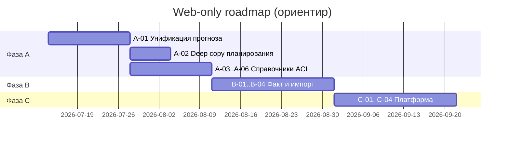

# План развития: только Web-стек

**Дата:** 2026-07-14  
**Статус:** утверждён  
**Область:** `backend/` + `client/` — единственный активный контур разработки

**Связанные документы:**
- [Бизнес-логика](../architecture/business-logic.md)
- [Roadmap совершенствования архитектуры](./architecture-comparison-and-improvement-roadmap.md)
- [Development roadmap](../../docs/development_roadmap.md)

---

## 1. Политика разработки

| Решение | Описание |
|---------|----------|
| **Активный стек** | ASP.NET Core 8 (`backend/`) + React/TypeScript (`client/`) |
| **WPF вне scope** | `EngineeringPerformance.App/` и корневой `EngineeringPerformance.Infrastructure/` — **не развиваем**, не сверяем при ревью, не цель паритета |
| **Единая математика** | `PerformanceCalculationEngine`, `LaborIntensityCalculator`, `ForecastCalculation` в `backend/EngineeringPerformance.Application/` |
| **Критерий готовности** | Функциональность и корректность расчётов в web; тесты backend + E2E |

WPF остаётся в репозитории как исторический артефакт до явного удаления; см. [wpf-reference-archive.md](../architecture/wpf-reference-archive.md).

---

## 2. Приоритеты по бизнес-логике

### Фаза A — Планирование и справочники (критично)

| ID | Задача | Файлы | Критерий приёмки |
|----|--------|-------|------------------|
| A-01 | Унифицировать прогноз: `ProjectForecastService` на `LaborIntensityCalculator` | `ProjectForecastService.cs`, `ForecastCalculation.cs` | Отчёт планирования = те же часы, что `ProjectsPageGridBuilder` / ForecastPanel |
| A-02 | Deep copy: `PlanningScenario` + LI-поля PPV | `ProjectVersionDeepCopyService.cs` | После копии версии сохраняются сценарий и `LaborIntensityBase/Pessimistic/Optimistic` |
| A-03 | UI: предупреждение при fallback без нормы на Plan | `ForecastPanel.tsx`, `PlanningTab.tsx` | Явное сообщение, если норма отсутствует и PLI нет |
| A-04 | Валидация FK справочников при CRUD | `DirectoryFacade.cs`, validators | Нельзя сохранить несуществующий `ClassifierId` / `UnitId` |
| A-05 | ACL на `GET /api/dictionaries/all` | `DictionariesController.cs`, `Api.Tests` | 403 без `References:Read` |
| A-06 | Решение по `IicNormId` на КФО | Domain + UI | Удалить поле или задокументировать и использовать |

### Фаза B — Факт, сравнение, импорт

| ID | Задача | Файлы | Критерий приёмки |
|----|--------|-------|------------------|
| B-01 | Единый взвешенный Z в отчётах факта | `FactAssessmentPipeline`, `ProjectVersionAnalysisTotalsCalculator` | Одинаковый итог на вкладке и в PDF |
| B-02 | API integration-тесты импорта | `Api.Tests/ImportApiTests.cs`, fixtures | PPV, LI, equipment — happy path + ошибки |
| B-03 | Импорт списка проектов: реализовать или 501 | `ProjectsController`, UI | Нет «тихого» stub |
| B-04 | Групповой тренд / групповой анализ | `GroupAnalyticsService`, UI | ✅ Анализ по Program/Customer; тренд → `/analytics/trends` |

### Фаза C — Платформа и UX

| ID | Задача | Источник |
|----|--------|----------|
| C-01 | Gate вкладок проекта по permissions | `development_roadmap.md` S0-06 |
| C-02 | TanStack Query на тяжёлых экранах | `architecture-comparison-and-improvement-roadmap.md` этап 2 |
| C-03 | FluentValidation + Zod на write-path | этап 3 roadmap |
| C-04 | Testcontainers в CI без silent skip | `development_roadmap.md` S2-01 |

---

## 3. Что **не** делаем

- Портирование фич в WPF и обратный паритет с desktop
- Сверка расчётов с `EngineeringPerformance.App`
- Задачи вида «как в WPF `PlanningForm`» — только как **историческая справка**, реализация в web по [business-logic.md](../architecture/business-logic.md)
- Поддержка dual-stack CI для WPF (сборка solution для desktop — опционально, не блокер релиза web)

---

## 4. Вехи

---

## 5. Метрики готовности

- [x] Нет расхождения часов между ForecastPanel и отчётом планирования (A-01 + FIX-01)
- [x] Документ [business-logic.md](../architecture/business-logic.md) без ссылок на WPF как активный стек
- [x] Backend tests green в CI без skip по БД
- [ ] E2E: полный suite (добавлены group-analysis; PDF smoke уже есть)
- [ ] UAT checklist `_doc/plans/uat-phase4-checklist.md` — только web-клиент

---

## 6. История

| Дата | Изменение |
|------|-----------|
| 2026-07-14 | Аудит orchestration: FIX/PDF/IMP + docs sync |
| 2026-07-14 | Фазы A/B/C: унификация прогноза, deep copy, FK справочников, weighted Z, import/ACL тесты, TanStack Query справочники |
| 2026-07-14 | Создан план: WPF вне scope, приоритет планирование + справочники |
